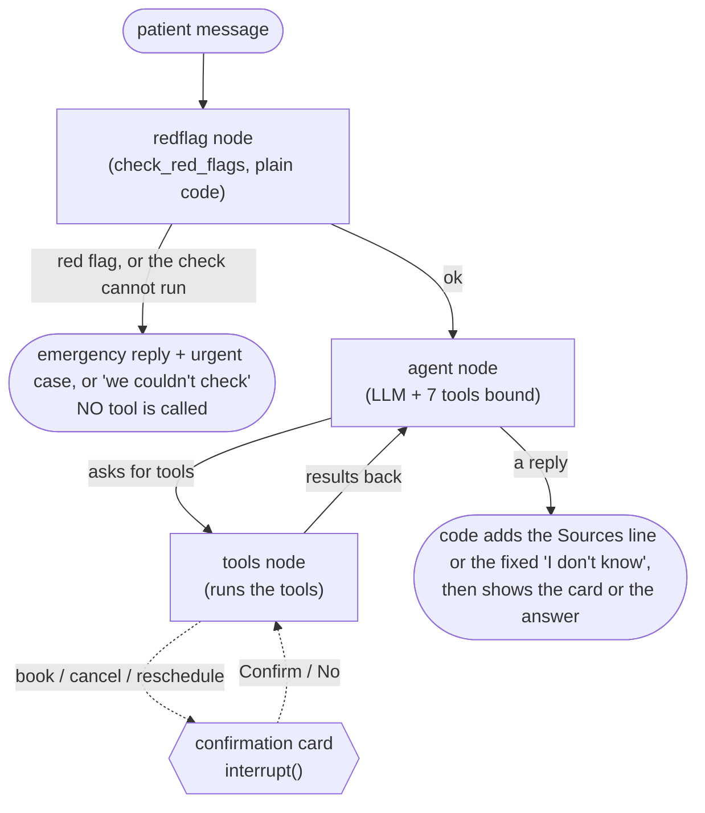
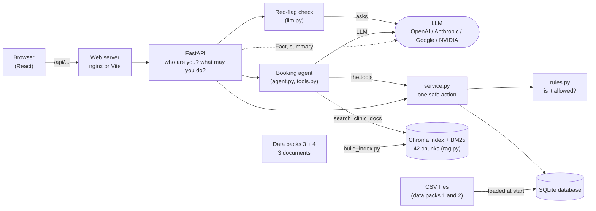

# 👁️ NetraCare: A Chat Agent That Books for the Patient (Iteration 4)

A website for a (fictional) eye clinic. Patients book appointments, Staff manage the day, Doctors see their schedule.
This folder holds **all four iterations together**: the Iteration 1 booking site, the Iteration 2 AI features, the Iteration 3 knowledge-base chat, and the
Iteration 4 **booking agent**: the patient chat can now find free times and book, cancel or reschedule, after the patient confirms on a card.
**The AI never decides a booking:** every booking still goes through the same plain-Python clinic rules in `rules.py`. The agent only chooses and explains.

> All data is synthetic (course data packs 1, 2, 3 and 4). Every AI feature uses a real language model: there is no stand-in model anywhere.

## ✨ What's new in Iteration 4

| Feature | What it does | Who decides? |
|---|---|---|
| 🤖 **Booking agent in the chat** | "Book my retina follow-up with Dr. Shah this Friday morning, the earliest time" → the agent looks up free times, asks for the reason if it is missing, and shows a **confirmation card**. "Actually, make it the afternoon" → one card to move it. It also answers clinic questions with sources, as in Iteration 3. | The agent (an LLM) picks tools and words the reply. |
| ✅ **Confirm before every action** | Book, cancel and reschedule pause at a card with **Confirm** and **No**. Nothing changes in the database until Confirm. A typed message while a card is waiting counts as No. | The patient |
| 🧰 **7 tools over the same API** | `search_clinic_docs`, `list_doctors`, `find_slots`, `my_appointments`, `book_appointment`, `cancel_appointment`, `reschedule_appointment`. The tools call the same functions the website uses; a tool never checks a rule itself and never writes to the database directly. | The API (`rules.py`) allows or refuses. A refusal comes back as a normal result with its reason code and the agent explains it. |
| 🔒 **The patient comes from the login** | The patient ID is passed through the graph's config, not as a tool argument, so the model can never act for someone else. Asking to cancel another patient's appointment is refused and reveals nothing. | Your code |
| 🧠 **Conversation memory** | A LangGraph checkpointer keeps each conversation by `thread_id`; the model sees the last 20 messages. "New chat" and logging out start a new thread. Nothing from the chat is saved in the database, except what the tools do and urgent cases. | Your code |
| 🕑 **Staff approve late changes** | A patient's cancel or reschedule inside 2 hours is saved as a request; the appointment stays booked. Staff Approve (carried out as Staff) or Reject, and the patient sees the request's status next to the appointment. | Staff |
| 🏠 **Bento home page** | A bento-grid hero of soft pastel tiles (headline, emergency call, chat assistant "Ask now", specialists built from the doctor list, opening days). It stacks to one column below 820 px. The public, read-only `GET /slots/preview` is still available. |
| 🎨 **One colour palette** | A single palette on every page (warm white page, warm near-black ink, pastel tiles, one emergency red), defined once as tokens in `frontend/src/styles.css`; coral is a fill only, coral text uses `--accent-text`. App shell with tabs per role, redesigned chat, Staff summary tiles, empty and loading states, accessible tabs and focus rings, phone layout. |
| 🏖️ **Doctor leave and rebooking (R7)** | A doctor marks leave for a morning, an afternoon or a full day. Bookings in that session are refused (`DOCTOR_ON_LEAVE`); the affected appointments are cancelled and **plain code** proposes a new time for each (a new consultation: the earliest free slot with any doctor of the speciality; a follow-up: the same doctor's next free slot). Staff Approve or Reject each; the patient sees "Moved because Dr. … is on leave". | Plain code proposes, Staff decide |

**One message, step by step**



1. **Red-flag node** (code): the patient's message goes through `check_red_flags`. A red flag ends the turn: the emergency message in red, an urgent case "from chat", **no tools**.
2. **Agent node:** the model gets its instructions, today's date and a 30-day calendar (each day "open" or "holiday"), the patient's name, age, upcoming appointments and past visits (no doctor notes, no health details), and the conversation. It answers, asks a question, or asks for tools.
3. **Tools node:** runs the tools and hands the results back. This loops, up to a step limit (then "Sorry, I can't finish that just now…").
4. **Confirm:** book, cancel and reschedule call `interrupt()` with a one-line summary before they touch the API. The browser shows the card and answers with `{thread_id, confirm: true|false}`.
5. **The API decides:** the tool calls the same rules check as the website. A refusal comes back with its reason code and the agent explains it and offers free times.
6. **Code finishes the reply:** sources come from the document search result, never from the model.

| Decision | Made by |
|---|---|
| Which tools to call, which free time to offer, how to explain a refusal | The agent (the LLM) |
| Whether a booking, cancel or reschedule is allowed | Your API, with the clinic rules |
| Whether to go ahead with an action | The patient, on the confirmation card |
| A patient's cancel or reschedule inside 2 hours; rebooking after doctor leave | Staff |
| Red flags, which patient is acting, the sources and "I don't know" | Your code, never the LLM |

The graph is also saved as [`graph.mmd`](graph.mmd).

---

## What came with Iteration 3 (still here)
| Feature | What it does | AI or plain code? |
|---|---|---|
| 💬 **Patient chat ("Ask NetraCare")** | A patient asks about timings, fees, what to bring, dilation, procedures and doctors, or describes a problem in their own words. The answer shows **where it came from** (`Sources: procedures.md › Cataract surgery`), or says **"I don't know"**. Follow-up questions work in the same conversation. | AI writes the answer. **Code** builds the sources, the fixed "I don't know" and the emergency message. |
| 🧭 **Speciality routing** | "My optician said the pressure in my eyes is high" → "A Glaucoma specialist can assess this. At NetraCare that is Dr. Meera Iyer. The doctor will assess you at your visit." It never says what the problem might be. | AI picks the speciality from `doctors.md`. Code adds the sources. |
| 🛡️ **Red-flag check in the chat** | Every chat message goes through the same red-flag check as booking, **before** anything else. A red flag gets the emergency message in red, no answer, and an urgent case for Staff marked "from chat". | Same check as Iteration 2 |
| 🔎 **Search debug view (Staff)** | Staff type a question and see the top 4 chunks from keyword search, vector search and hybrid search, each with file, section and score. | Plain code |
| 📚 **Knowledge base** | The three documents of data pack 3 are split into 40 chunks (one per `##` section; two long ones are split in two), embedded, and stored in a Chroma index. Built once with `python build_index.py`. | Embeddings (a real local model, free) |

The patient chat of Iteration 3 (documents, hybrid search with sources, "I don't know", speciality routing, the red-flag check, the Staff search debug view) is
still there, but it now runs **inside the agent**: the `search_clinic_docs` tool is Iteration 3's answer chain. The separate rewrite step is gone: the agent writes a
complete question when it calls the tool. Data pack 4's updated policy document (booking through the chat, doctor leave) is used instead of the data pack 3 copy;
**both packs stay exactly as given** (the index is built from `data3/documents` with `data4/documents` laid over it).

---

## What came with Iteration 2 (still here)

---

| Feature | What it does | AI or plain code? |
|---|---|---|
| 🛡️ **Red-flag check** | When someone books, the reason is checked. A sight-threatening symptom shows an emergency message in red and creates an **urgent case** for Staff. | AI decides *red flag or not*. Code shows the message, saves the case and runs the booking rules. |
| 💡 **Fact of the Day** | Patients see a short, friendly eye fact when they log in, and can press Refresh for a different one. **The fact is saved for each patient**, so the next login shows it instantly and Refresh replaces it. | AI writes the fact. Code saves it and adds the line "General information, not medical advice". |
| 📝 **Doctor summary** | A doctor opens a patient and sees a summary of the recorded notes **streaming onto the screen**, in three sections (Today, Background, Past visits). **Every past visit shows its date.** | AI writes only the wording of each visit's note. Code fills Today, Background, and every date, doctor and speciality from the records, limits it to 120 words and labels it. |
| 🔔 **Urgent badge** | Staff see a badge with the number of unseen urgent cases (also in the browser tab title). | Plain code |
| ✍️ **Reason** (required) | The booking form asks "What is the reason for your visit?" (up to 300 characters). | Plain code |
| 📋 **Doctor note** (required) | A doctor writes a note when marking a visit completed. | Plain code |

More detail on the stretch goals is in [section 'Stretch goals'](#-stretch-goals) below.

**If the AI is not available** the app still works, but safely: the Fact shows a fixed fallback fact, the summary says
"Summary unavailable. See the notes below.", and **booking is refused** ("We couldn't check your reason just now...") because the safety check cannot run.

## 🧑‍🤝‍🧑 What each role can do

| Role | Can do |
|---|---|
| 🧑 **Patient** | Log in, see a Fact of the Day, **chat with the booking assistant** (find free times, book, cancel, reschedule, ask about the clinic), see doctors, see free times, book (with a reason), cancel, reschedule, see their own appointments |
| 🧑‍💼 **Staff** | Everything from Iteration 1 (all appointments, book for anyone, walk-ins, cancel, approvals, holidays, weekly schedules, week view) **plus** enter the reason when booking, see **urgent cases** at the top (red) and mark them seen, see the **Urgent** tag (red flags from the chat are marked "from chat"), use the **search debug view**, **approve or reject** late cancels and reschedules, and **approve or reject the new times after a doctor's leave** |
| 🩺 **Doctor** | See their schedule and each patient's reason, write a note when completing a visit, **mark leave**, **open a patient to see the AI summary** and the full past notes |

## 🚀 Run it

**1. Set your AI key (optional, but needed for the AI features)**

Copy `backend/.env.example` to `backend/.env` and fill in one provider:
```
LLM_PROVIDER=nvidia            # openai, anthropic, google or nvidia
NVIDIA_API_KEY=nvapi-...       # the key for that provider
NVIDIA_API_KEY_2=nvapi-...     # optional: a second key (up to _9) of the same provider; the app uses the keys in turn
```
The chat's embeddings need **no key**: by default they run on your own computer (`EMBEDDING_PROVIDER=local`).
`.env` is listed in `.gitignore`, so it is never committed. Never put a key anywhere else.

**2. Start the app, with Docker (easiest)**
```bash
docker compose up --build
```
Open **http://localhost:5176**. API docs: http://localhost:8004/docs.
The first build takes several minutes: it downloads the embedding model and **builds the knowledge-base index once** (from data packs 3 and 4), inside the image.
After you change a document, rebuild the index: `docker compose exec backend python build_index.py`.
`docker compose down` stops it (data is kept); `docker compose down -v` deletes the data.
The key is passed to the container when it starts. It is **not** stored in the image.

**Or without Docker** (needs Python 3.10+ and Node.js 18+)
```bash
cd backend
pip install -r requirements.txt
python build_index.py                     # builds the knowledge-base index ONCE (also after a document changes)
python -m uvicorn app.main:app --port 8000
```
```bash
cd frontend
npm install
npm run dev
```
Open **http://localhost:5173**. The first start creates `backend/netracare.db` from the CSV files.

**Logging in** (no passwords, so this is classroom-level security only)

| Role | Enter |
|---|---|
| Patient | A mobile number and name from [`patients.csv`](backend/data/patients.csv), for example `9000000001` / `Asha Verma` |
| Staff | Any name |
| Doctor | Pick a name from the list |

## 🏗️ How it works



**Booking, step by step**
1. The patient (or Staff) fills in doctor, time and **reason** and clicks a time.
2. The server checks the login and role, and that the reason is not empty and is at most 300 characters.
3. **Red-flag check:** the reason goes to the AI, which answers in a fixed shape (`red_flag`, `category`, `why`). When it is unsure, it flags.
   - Red flag → the case is saved for Staff *before* anything else, and the emergency message is returned.
   - The check cannot run (no key, timeout, unreadable reply) → the booking is refused and nothing is saved.
4. **The normal clinic rules run, unchanged** (`rules.py`). If a rule fails, the booking is refused, but an urgent case from step 3 still stands.
5. If all rules pass, one row is saved, tagged **Urgent** if step 3 flagged it.

**What is AI and what is code**

| AI (language model) | Plain code |
|---|---|
| Is this reason a red flag, and which category | Whether a booking is allowed |
| The wording of the Fact of the Day | The emergency message and the caveat (word for word) |
| The wording of the doctor summary | Who may see what, the 120-word limit, the labels, all fallbacks |
| The wording of a chat answer, which tools to call, which free time to offer | Whether anything is allowed (`rules.py`), the confirmation card, the **Sources** line, the fixed "I don't know", the emergency message, which patient is acting, who may chat |

The retrieval and the answer chain are in [`backend/app/rag.py`](backend/app/rag.py); the agent graph and its prompt are in [`backend/app/agent.py`](backend/app/agent.py); the tools are in [`backend/app/tools.py`](backend/app/tools.py); the one booking path and doctor leave are in [`backend/app/ops.py`](backend/app/ops.py).
The booking AI code is all in [`backend/app/llm.py`](backend/app/llm.py): three small LangChain chains (prompt, model, output parser). The red-flag chain uses a model setting of
temperature 0 and a Pydantic parser; the patient's text goes into the prompt as data between `<reason>` tags, not as instructions.

## 📋 Clinic rules (Iteration 1, plus doctor leave)

Checked in this order, after the red-flag check. Each refusal has a short code and a plain sentence.

| # | Rule | Code |
|---|---|---|
| 1 | Start on a 10-minute mark (new consultation = 20 min, follow-up = 10 min) | `INVALID_START_TIME` |
| 2 | Not in the past | `IN_PAST` |
| 3 | At most 30 days ahead | `BEYOND_30_DAYS` |
| 4 | Not on a Sunday | `CLINIC_CLOSED` |
| 5 | Not on a holiday | `HOLIDAY` |
| 6 | Inside 09:00-13:00 or 14:00-18:00 | `OUTSIDE_SESSION` |
| 7 | Must finish before the session ends | `ENDS_AFTER_SESSION` |
| 8 | Doctor is at the clinic that session | `DOCTOR_OFF` |
| 9 | Doctor is not in surgery | `SURGERY_SESSION` |
| 9b | Doctor has not marked leave for that session (Iteration 4) | `DOCTOR_ON_LEAVE` |
| 10 | Doctor covers that speciality | `SPECIALITY_MISMATCH` |
| 11 | Slot is not already taken | `DOUBLE_BOOKED` |
| 12 | A follow-up needs a completed earlier visit, with the same doctor | `NO_PREVIOUS_VISIT`, `FOLLOW_UP_DIFFERENT_DOCTOR` |
| 13 | One active booking per speciality | `ACTIVE_BOOKING_EXISTS` |
| 14 | A patient can cancel or reschedule until 2 hours before. After that: "Please contact Staff" (the request is saved for Staff to approve or reject) | `INSIDE_2_HOURS` |

New in Iteration 2: `REASON_REQUIRED`, `REASON_TOO_LONG`, `NOTE_REQUIRED`, `NOTE_TOO_LONG`, `RED_FLAG_CHECK_FAILED`.

## 🔌 API

All paths start with `/api` in the browser (the web server removes it before calling FastAPI). Try them at `/docs`.
Protected calls need the header `Authorization: Bearer <token>`.

| Method | Path | Who | What it does |
|---|---|---|---|
| GET | `/health` | public | Is the server up, and what time does the clinic think it is |
| POST | `/login` | public | Log in as `patient`, `staff` or `doctor`; returns a token |
| GET | `/doctors` | public | The 5 doctors and their specialities |
| GET | `/me` | any logged-in user | Who am I |
| GET | `/schedule` | any logged-in user | Doctors' weekly schedule |
| GET | `/holidays` | any logged-in user | Clinic holidays |
| GET | `/slots/preview` | **public** | `?speciality=` The next free new-consultation times for a speciality (up to 6), with the doctors who cover it. Times and doctor names only. Used by the home page |
| GET | `/slots` | any logged-in user | Free start times for a doctor, date, speciality and visit type |
| GET | `/appointments` | any logged-in user | List appointments (patients and doctors only see their own; only doctors see the doctor's note) |
| POST | `/appointments` | patient, staff | Book. Needs a `reason`. Runs the red-flag check first. |
| POST | `/appointments/{appointment_id}/cancel` | patient, staff | Cancel |
| POST | `/appointments/{appointment_id}/reschedule` | patient, staff | Move to another time (the old one is cancelled only if the new one is accepted) |
| POST | `/appointments/{appointment_id}/complete` | doctor | Mark the doctor's own visit completed. Needs a `note`. |
| GET | `/fact-of-the-day` | patient | The patient's saved eye fact (instant). `?refresh=true` writes a different one and saves it as the replacement. |
| GET | `/doctor/patients/{patient_id}/summary` | doctor | Structured AI summary of the recorded notes (`?appointment_id=` one on the doctor's own schedule) |
| GET | `/doctor/patients/{patient_id}/summary/stream` | doctor | The same summary streamed as it is written (server-sent events: `meta`, many `partial`, one `final`) |
| POST | `/chat` | patient | `{thread_id, message}` (up to 500 characters) or `{thread_id, confirm: true\|false}` from the card. Returns `kind` (`answer`, `pending`, `idk`, `emergency`, `check_failed` or `error`), `reply`, `sources`, `tool_calls` and, while an action waits, `pending_action` (`{action, summary}`). The patient comes from the login. |
| GET | `/staff/search-debug` | staff | `?q=` the top 4 chunks from keyword, vector and hybrid search, each with file, section and score |
| POST | `/doctor/leave` | doctor | Mark leave `{date, session: AM\|PM\|FULL}` within the next 30 days; cancels the affected appointments and proposes new times |
| GET | `/doctor/leave` | doctor | The doctor's own leave |
| GET | `/staff/rebookings` | staff | Proposals waiting for Staff (`no_slot` rows say "No slot: call the patient") |
| POST | `/staff/rebookings/{rebooking_id}/approve` | staff | The proposal becomes a booked appointment |
| POST | `/staff/rebookings/{rebooking_id}/reject` | staff | The proposal is dropped and its slot is free again |
| GET | `/urgent-cases` | staff | Urgent cases not yet seen (each has `source`: `booking` or `chat`) |
| POST | `/urgent-cases/{urgent_id}/seen` | staff | Mark an urgent case seen |
| GET | `/patients` | staff | List patients |
| POST | `/patients` | staff | Register a walk-in patient |
| GET | `/staff/approvals` | staff | Late cancel/reschedule requests waiting for Staff |
| POST | `/staff/approvals/{approval_id}/approve` | staff | Approve and carry it out |
| POST | `/staff/approvals/{approval_id}/reject` | staff | Reject; the appointment stays |
| POST | `/holidays` | staff | Add a holiday |
| DELETE | `/holidays/{date}` | staff | Remove a holiday |
| PUT | `/schedule` | staff | Set a doctor's status (OPD, SURGERY or OFF) for a day and session |
| GET | `/calendar` | staff, doctor | One doctor's week (a doctor always gets their own) |

When a rule is broken the reply is HTTP 409 like this (a red-flag booking that is refused also carries an `emergency` object):
```json
{ "detail": { "code": "DOCTOR_OFF", "message": "Dr. Meera Iyer is not at the clinic on Thursdays.", "to_staff": false } }
```
Other errors: 401 not logged in, 403 not allowed for your role, 404 not found, 422 bad input, 503 the red-flag check could not run.

## 🗂️ Data

| Data pack | File | Rows | Used for |
|---|---|---|---|
| 1 | `backend/data/doctors.csv` | 5 | Doctors and their specialities |
| 1 | `backend/data/weekly_schedule.csv` | 60 | OPD / SURGERY / OFF for each doctor, day and session |
| 1 | `backend/data/holidays.csv` | 30 | Days the clinic is closed |
| 1 | `backend/data/patients.csv` | 25 | Patients |
| 1 | `backend/data/stretch/appointments_seed.csv` | 19 | Sample bookings, only if you ask; used by the tests |
| 1 | `backend/data/stretch/rule_tests.csv` | 38 | Test cases for the rules |
| 2 | `backend/data2/past_visits.csv` | 27 | Completed visits with the patient's reason and the doctor's note |
| 2 | `backend/data2/patient_profiles.csv` | 25 | General health and allergies |
| 2 | `backend/data2/reason_samples.csv` | 35 | Reasons labelled red flag yes/no, to test the AI check |
| 3 | `backend/data3/documents/doctors.md` | 15 sections | Which speciality sees which problems; each doctor's specialities and OPD days |
| 3 | `backend/data3/documents/procedures.md` | 9 sections | Tests and procedures: what happens, before and after, indicative cost |
| 3 | `backend/data3/documents/clinic_policy_faq.md` | 14 sections | Timings, booking, fees, cancelling, what to bring, dilation, emergencies |
| 4 | `backend/data4/documents/clinic_policy_faq.md` | 16 sections | Replaces the data pack 3 policy document (new: booking through the chat, doctor leave) |
| 4 | `backend/data4/agent_scenarios.csv` | 24 | Chat scenarios with the expected tools and database result, on the fixed clock |
| 4 | `backend/data4/leave_scenarios.csv` | 5 | Doctor leave cases with the rebooking the code should propose |
| 3 | `backend/data3/questions.csv` | 20 | Patient questions with the expected source; Q16 to Q20 should get "I don't know" |
| 3 | `backend/data3/routing_samples.csv` | 20 | Problems in patients' own words, labelled with the right speciality |

There are **no upcoming bookings** at the start. Data pack 2's 27 past visits are loaded as completed appointments, so follow-ups work (for example Asha Verma can book a Retina follow-up with Dr. Shah).

Settings (environment variables):

| Variable | Meaning |
|---|---|
| `LLM_PROVIDER` | `openai`, `anthropic`, `google` or `nvidia` (in `backend/.env`) |
| `LLM_MODEL` | Model name. If blank: `gpt-4o-mini`, `claude-haiku-5-5`, `gemini-2.0-flash` or `nvidia/nemotron-3.5-lightning-30b-a3b` |
| `LLM_TIMEOUT` | Seconds before an AI call gives up (default 20) |
| `LLM_MAX_RETRIES` | Retries after a short provider error such as HTTP 429 "too many requests" (default 4) |
| `LLM_RATE_LIMIT_WAITS` | Seconds to wait before each further try when the provider answers HTTP 429 (default `4,8,16`; about 1 second when a second key can take the next try). Any other error is not retried |
| `NVIDIA_API_KEY_2` ... `_9` | Optional extra keys for the same provider. They are used in turn, which spreads the calls over several rate limits |
| `LLM_FALLBACK_MODELS` | Optional backup models, comma separated (`provider:model`). Tried in order if the main model fails; booking is refused only if all of them fail. Blank = main model only |
| `NVIDIA_BASE_URL` | NVIDIA only: the API address (default `https://integrate.api.nvidia.com/v1`) |
| `NETRACARE_SEED_APPOINTMENTS` | Set to `1` to also load the 19 sample bookings |
| `NETRACARE_SKIP_PACK2` | Set to `1` to skip data pack 2 |
| `CLINIC_NOW` | Freeze the clinic clock, for example `2026-11-02T10:00` (demos and tests) |
| `CLINIC_TZ` | Docker only: the clinic's timezone (default `Asia/Kolkata`) |
| `NETRACARE_DB` | Where the SQLite file lives |
| `NETRACARE_DATA_DIR` | Where data pack 1 is |
| `NETRACARE_DATA2_DIR` | Where data pack 2 is |
| `NETRACARE_DATA3_DIR` / `NETRACARE_DATA4_DIR` | Where data pack 3 / 4 are |
| `NETRACARE_DOCS_DIR` | Tests only: use this folder of documents instead of data packs 3 and 4 |
| `NETRACARE_INDEX_DIR` | Where the Chroma index is saved (default `backend/chroma_db`) |
| `EMBEDDING_PROVIDER` | `local` (free, on your computer, the default), `openai` or `google` |
| `EMBEDDING_MODEL` | Optional model name. **If you change it, rebuild the index** (`python build_index.py`) |
| `BACKEND_PORT` | Dev server only: port of the backend (default `8000`) |

The four data pack folders are copied exactly as given, including their `.DS_Store` files.

Plus the key for your provider: `OPENAI_API_KEY`, `ANTHROPIC_API_KEY`, `GOOGLE_API_KEY` or `NVIDIA_API_KEY`.

## 🎯 Stretch goals

| # | Stretch goal | Where it lives | How it was checked |
|---|---|---|---|
| 1 | Automated red-flag tests on all 35 rows | `tests/test_reason_samples_live.py` | Real model: 37 passed, 0 missed, 0 wrong category, 0 false alarms |
| 2 | 10 hard cases of my own (Hindi, Hinglish, typos, ambiguous, long) | `tests/hard_cases.csv`, `tests/test_hard_cases_live.py` | Real model: 10 of 10 correct, 0 false alarms |
| 3 | Structured summary (Today, Background, Past visits) | `llm.py` (`SummaryResult`), `App.jsx` (`SummarySections`) | Offline tests, real model, real browser |
| 4 | The visit date on every past-visit line | `llm.check_summary` | The code checks each date against the records; a summary with an invented or missing date is replaced by the fallback line |
| 5 | The summary streams onto the doctor's screen | `GET /doctor/patients/{id}/summary/stream` | Real model and real browser: the text grows in many steps |
| 6 | The Fact of the Day is saved for each patient | table `patient_facts`, `main.py` | Offline tests and real browser: the second login shows the same fact instantly; Refresh replaces it |
| 7 | Switch provider and model through `.env` only | `llm.py` (`openai`, `anthropic`, `google`, `nvidia`), `compare_models.py` | Env switching is tested offline. **No model comparison was completed**: `compare_models.py` is written and ready, but only NVIDIA's `nemotron-3.5-lightning` was measured (45 of 45 cases correct). Run `python compare_models.py provider:model provider:model` to compare others. |
| 8 | A badge with the number of unseen urgent cases | `UrgentBadge` in `App.jsx` | Real browser: 0, then 1, then 0 after Mark seen; the tab title follows |

## 🧪 Tests

**There is no stand-in model anywhere.** Every test that needs an AI answer calls the real model from your `.env`, so the tests need your key and take
a while (every booking and chat message is a real call). If no key is found, the run stops with a clear message instead of passing silently.

```bash
cd backend
pip install -r requirements-dev.txt
python -m pytest -q                  # everything except the full chat scoring below
python -m pytest tests/test_chat_live.py -v -s    # the 20 questions + 20 routing samples of data pack 3, asked of the agent, with a score
python -m pytest tests/test_agent_scenarios_live.py -v -s   # the 24 scenarios of data pack 4, checked against the database
```
A failing model is produced the real way: no key, a model name that does not exist, or a timeout too short for any reply. Plain-code logic (what happens to
a reply once it arrives: building sources, the fixed "I don't know", the date checks on a summary) is tested by calling that code directly.

### Results

**Home page and palette (real browser, Chrome, against the running Docker app).** 40 of 40 checks pass: exact wording, 12-column bento at 1280 px and 820 px, one column at 819 px and 360 px with the tiles in the specified order, no horizontal scroll, decorative circles never touching text at nine widths from 320 to 1280 px, tile colours equal to the tokens in `styles.css`, every hero text at least 4.5:1, a visible focus outline on every button and link, no transitions with reduced motion, "Ask now" opening the symptom form, and the specialist chips and the "Five specialists" label built from the real doctor list.

**Real-model results.** Every number below is from a run against the real NVIDIA model (`nemotron-3.5-lightning-30b-a3b`), with two keys used in turn. The model is not perfectly consistent, so a result can differ by one check from run to run. The numbers come from the latest complete run of each kind; a few small prompt and retry changes were made after some of them (listed under the table), and the whole set was not run again afterwards.

| Check | Result | Notes |
|---|---|---|
| Booking agent scenarios (`agent_scenarios.csv`, 24, checked against the database) | **24 of 24 passed** | The tools called, the booking made and the reply are all checked |
| Chat questions (data pack 3, 20 questions, with sources) | **20 of 20 passed** | Answer from the documents, the right source, or the fixed "I don't know" |
| Routing samples R01 to R10 (target: at least 9) | **9 of 10 correct** | The miss is R06 ("sandy and tired eyes after the laptop"): it goes to General instead of Dry eye in some runs. It passed 2 of 3 later runs, so it is flaky, not fixed |
| Routing samples R11 to R20 | **10 of 10 passed** | Includes the Hinglish message R19 and the non-eye message R20 |
| Full test suite (everything else: rules, API, tools, agent, RAG, 39 clinic rule cases) | **279 passed, 1 failed** | The one failure was a dropped network connection on the test computer; it passed when run again after the retry now covers dropped connections |
| Real browser check of the booking agent (Chrome, fixed clock, a copy of the database) | **22 of 22 passed** | Confirmation card, nothing booked until Confirm, reschedule in the same chat, No, sources, "I don't know", a refusal the agent explains, a red flag with its urgent case, doctor leave with the rebooking. No server, page or console errors |
| Home page browser check | **40 of 40 passed** | At 1280, 820 and 360 px |

**What changed after those runs:** the agent's prompt got a few more rules (reply after a No, never switch speciality, offer a different day in words first); the answer prompt was told to start with the speciality; the retry now also covers short 502/503/504 provider errors and dropped connections, and a second API key can be used in turn. The browser check and the tests that touch these parts were run on the final code, but the 24 scenarios and the 40 chat checks were not repeated after the very last wording change (the reply after "No"). Treat their numbers as a very good indication, not as a promise for every run.

**Known open items:** R06 is flaky, as described above. The six stretch goals listed under "Not built" are not part of these results.


## 📁 Project layout

```
backend/
  app/
    main.py       the API routes and role checks
    service.py    the actions (book, cancel, complete, urgent cases, ...)
    rules.py      every clinic rule
    llm.py        the booking AI: model setup, Fact of the Day, red-flag check, doctor summary
    rag.py        the knowledge base: chunking, Chroma, BM25, hybrid search, the rewrite and answer chains
    agent.py      the LangGraph agent: the graph, its prompt, memory, one chat turn
    tools.py      the 7 tools (a thin layer over the same API functions the website uses)
    ops.py        the ONE booking path, and doctor leave + Staff rebooking (plain code)
    db.py         database tables and CSV loading
    config.py     settings and the clinic clock
  data/           data pack 1 (CSV files)
  data2/          data pack 2 (CSV files)
  data3/          data pack 3 (the 3 documents, questions.csv, routing_samples.csv)
  data4/          data pack 4 (the updated policy document, agent_scenarios.csv, leave_scenarios.csv)
  build_index.py  builds the knowledge-base index (run once, and after a document changes)
  chroma_db/      the saved index
  tests/          the automated tests (+ hard_cases.csv, my own 10 extra red-flag cases)
  compare_models.py   runs the same 45 red-flag cases on any models you name
  .env.example    copy to .env and add your key
frontend/
  src/App.jsx     all the screens
  src/api.js      talks to the API
docker-compose.yml   runs backend + frontend together
```

## 🛠️ Built with
Python, FastAPI, SQLite (no ORM), LangChain, LangGraph, Chroma, BM25, sentence-transformers · React 18, Vite 5 · pytest · Docker Compose, nginx

## ⚠️ Limitations
- Logins have no passwords. Tokens never expire and there is no logout call.
- The AI can be slow or unavailable. The red-flag check then refuses the booking on purpose (you can reduce how often with `LLM_FALLBACK_MODELS`), so a patient with a real emergency is never booked silently, but routine patients must try again or call the clinic.
- A language model is not perfectly consistent: the same reason can occasionally be judged differently. That is why the check flags when unsure and every flag only costs Staff one click.
- The doctor summary is an AI rewrite of the notes, so it can paraphrase. The full notes always appear underneath for checking.
- Streaming is checked at every moment, not only at the end: code fills Today and Background from the records and copies each visit's date, doctor and speciality from the matching record. A date that is half-written or not in the records is never shown. Only the wording of each visit's note is the model's own, and the full notes always sit underneath.
- A fallback fact (shown when the AI is down) is never saved, so the next login tries the AI again.
- A doctor can mark any of their own booked visits completed, even a future one.
- The chat is only as good as the three documents and the real model: it can say "I don't know" for a question the documents do cover, or occasionally route to a neighbouring speciality. The measured scores are in the test results above.
- The chat does not stream its answer, and a source cannot be clicked to see the chunk (stretch goals, not built).
- Reranking, LlamaIndex, a multilingual embedding model, Weaviate, Agentic RAG and Graph RAG (stretch goals) are not built. Hinglish routing (R19) therefore depends on the embeddings and the model; it passed in the latest run.
- The first chat message after a restart can be slow while the embedding model loads (the server warms it in the background at startup).
- **The agent is a language model, so it is not perfectly consistent**: the same request can occasionally be handled in a different order or worded differently. The things that must never vary are decided by code, not the model: which patient is acting, every clinic rule, the confirmation card, the red-flag stop, and the sources. The measured scores are above.
- Conversations are kept in memory by the server (`InMemorySaver`): restarting the server clears them. This is what the handout asks for.
- The agent uses only the main model (`LLM_MODEL`); the backup models (`LLM_FALLBACK_MODELS`) apply to the booking AI and the document answers, not to the agent's own reasoning.
- Not built (stretch goals): doctor leave as a LangGraph workflow, the patient choosing a time after leave, a Staff assistant agent, a supervisor with two agents, showing the agent's progress while it works, and LangSmith tracing.
- The frontend has no automated tests.
