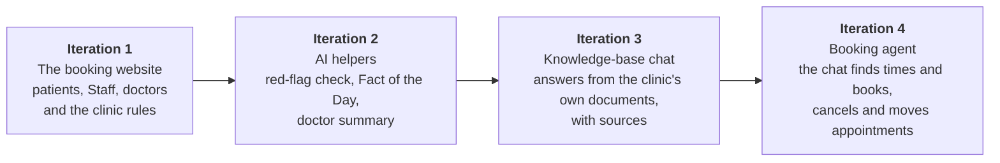
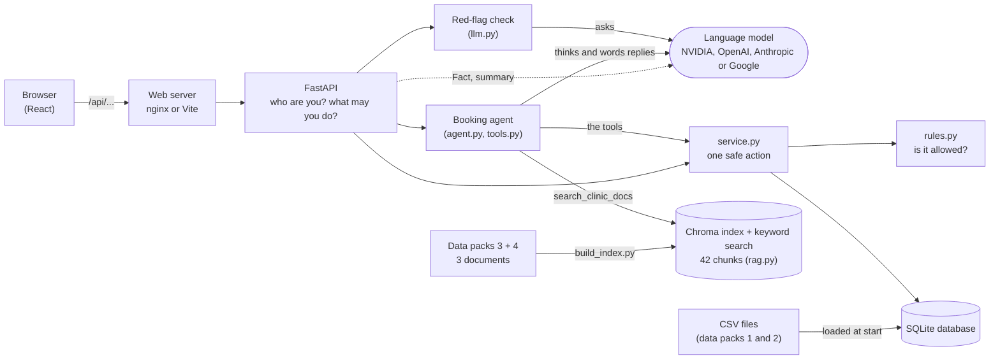
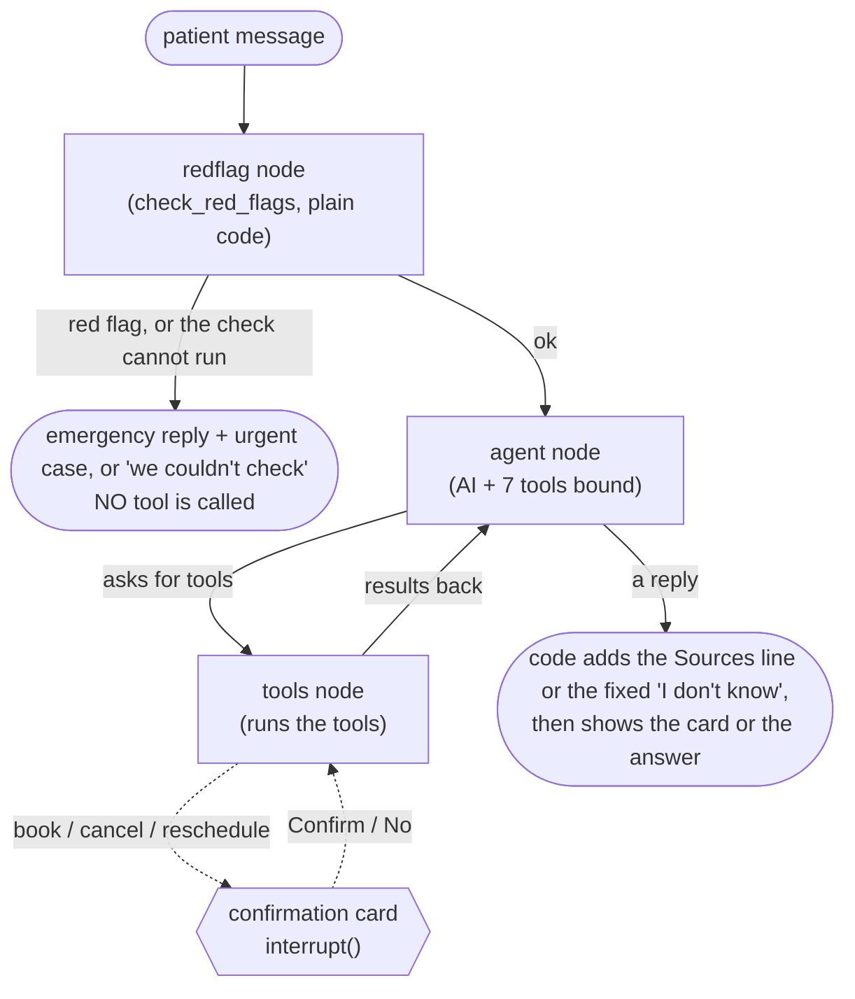
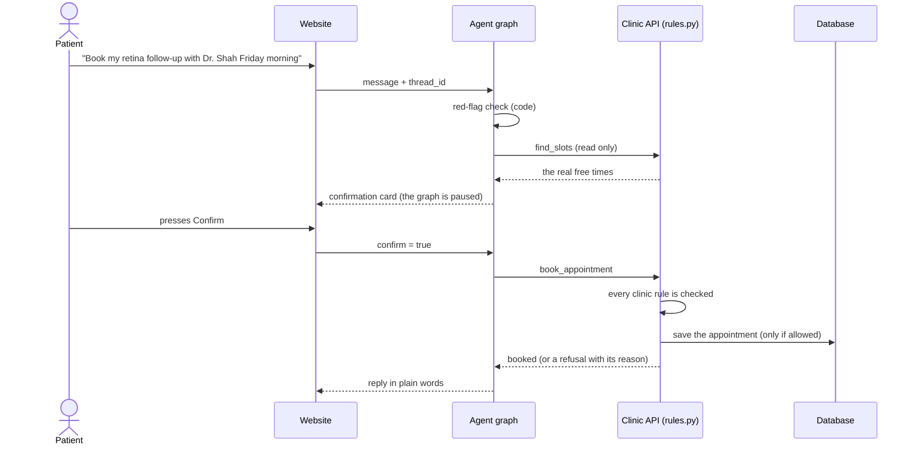
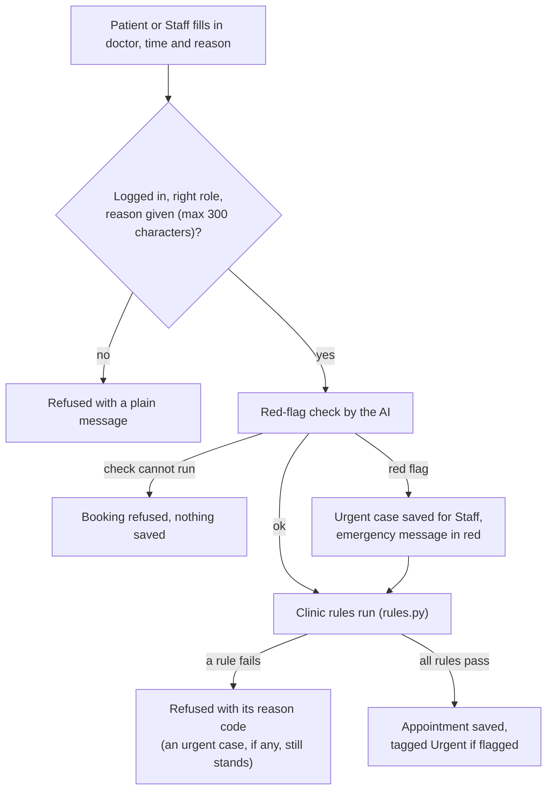
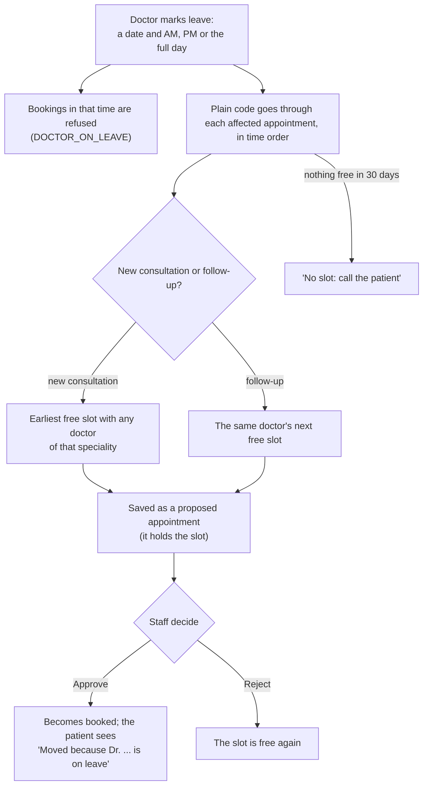

# 👁️ NetraCare: an eye-clinic website with a chat assistant that books for you

NetraCare is a (fictional) eye clinic. **Patients** book appointments, **Staff** run the clinic day, and **Doctors** see their schedule.
It was built in four steps (iterations), and this folder holds **all four together**. Each step added something new, and everything from the earlier
steps is still here and still works:



**The most important rule:** the AI never decides a booking. The clinic rules are plain Python code (`rules.py`), and every booking, from the website or
from the chat, goes through the same rules. The AI only understands what people write, chooses what to look up, and explains in plain words.

> All data is synthetic (course data packs 1 to 4). Every AI feature uses a **real language model**. There is no fake or stand-in model anywhere, not even in the tests.

---

## 1. What NetraCare can do today

### Iteration 1: the booking website
| Feature | What it does |
|---|---|
| 🔑 **Log in** | Patients log in with a mobile number and name, Staff with a name, Doctors by picking their name. (A classroom login: there are no passwords.) |
| 🩺 **Doctors and free times** | See the five doctors, their specialities, and the free start times for a day. |
| 📅 **Book** | Pick a doctor, speciality, visit type (new consultation 20 minutes, follow-up 10 minutes), day and time. Every clinic rule is checked (see the table in section 4). |
| ❌ **Cancel and 🔁 reschedule** | A patient can cancel or move their own appointment up to 2 hours before it starts. The old time is released only if the new time is accepted. |
| 🕑 **Late changes go to Staff** | A cancel or move inside 2 hours is saved as a request. The appointment stays booked until Staff approve or reject it. |
| 🧑‍💼 **Staff tools** | See all appointments, book for any patient, register a walk-in patient, cancel, approve or reject late requests, add or remove holidays, edit a doctor's weekly schedule (OPD, surgery or off), and see a doctor's week on a calendar. A change that would break an existing booking is refused. |
| 📋 **Doctor's day** | A doctor sees their own schedule and marks a visit completed. |

### Iteration 2: AI helpers
| Feature | What it does | AI or plain code? |
|---|---|---|
| 🛡️ **Red-flag check** | When someone books, the reason is checked. A sight-threatening symptom shows an emergency message in red and creates an **urgent case** for Staff. If the check cannot run, the booking is **refused**, so an emergency is never booked silently. | AI says "red flag or not". Code shows the message, saves the case and runs the rules. |
| 💡 **Fact of the Day** | A short, friendly eye fact when a patient logs in. It is saved for each patient, so the next login shows it at once. Refresh gives a different one. | AI writes it. Code saves it and adds "General information, not medical advice". |
| 📝 **Doctor summary** | A doctor opens a patient and watches a summary of the recorded notes appear as it is written (Today, Background, Past visits, with the date of every visit). | AI words each visit's note. Code fills the dates, doctors and specialities from the real records and keeps it short. |
| 🔔 **Urgent cases for Staff** | A red badge with the number of unseen urgent cases, a red list at the top of the Staff page, and a "Mark seen" button. | Plain code |
| ✍️ **Reason and note** | The booking form needs a reason (up to 300 characters). A doctor writes a note when completing a visit. | Plain code |

If the AI is not available, the app still works safely: the fact shows a fixed fallback fact, the summary says "Summary unavailable. See the notes below.",
and booking is refused with "We couldn't check your reason just now".

### Iteration 3: the knowledge-base chat
| Feature | What it does | AI or plain code? |
|---|---|---|
| 💬 **Ask NetraCare** | A patient asks about timings, fees, what to bring, dilation, procedures and doctors. The answer shows where it came from (for example `Sources: clinic_policy_faq.md › Consultation fees`) or says **"I don't know"** when the documents don't cover it. | AI writes the answer. Code builds the sources and the fixed "I don't know". |
| 🧭 **Speciality routing** | "My optician said the pressure in my eyes is high" gets "A Glaucoma specialist can assess this. At NetraCare that is Dr. Meera Iyer. The doctor will assess you at your visit." It never names a condition or suggests a treatment. | AI picks the speciality from the doctors document. |
| 🛡️ **Red flags in the chat** | Every chat message goes through the red-flag check first. A red flag gets the emergency message and an urgent case marked "from chat". | Same check as Iteration 2 |
| 🔎 **Search debug (Staff)** | Staff type a question and see the top 4 chunks from keyword, vector and combined search, each with file, section and score. | Plain code |
| 📚 **Knowledge base** | The clinic documents are cut into small pieces (one per section), turned into numbers (embeddings, run free on your own computer) and stored in a Chroma index. Search combines keyword search and meaning search, each counting half. | Embeddings |

### Iteration 4: the booking agent
| Feature | What it does | Who decides? |
|---|---|---|
| 🤖 **Booking in the chat** | "Book my retina follow-up with Dr. Shah this Friday morning, the earliest time." The agent looks up real free times and shows a **confirmation card**. "Actually, make it the afternoon" gives one card to move it. It also cancels, shows "What appointments do I have?", and still answers clinic questions with sources. | The agent (an AI) picks tools and words the reply. |
| ✅ **Confirm before every change** | Book, cancel and reschedule pause at a card with **Confirm** and **No**. Nothing changes until Confirm. A typed message while a card is waiting counts as No. | The patient |
| 🧰 **Seven tools** | `search_clinic_docs`, `list_doctors`, `find_slots`, `my_appointments`, `book_appointment`, `cancel_appointment`, `reschedule_appointment`. They are a thin layer over the same functions the website uses. A tool never checks a rule itself and never writes to the database directly. | The clinic API allows or refuses, and the agent explains a refusal. |
| 🔒 **The patient comes from the login** | The patient's ID is taken from the login and passed through the graph's settings, never as something the AI can choose. Asking to cancel someone else's appointment is refused and reveals nothing. | Code |
| 🧠 **Memory** | Each chat has a `thread_id` and the agent sees the last 20 messages. "New chat" and logging out start a fresh chat. Nothing from the chat is stored in the database except what the tools do and urgent cases. | Code |
| 🏖️ **Doctor leave and rebooking** | A doctor marks a morning, afternoon or full day of leave. Bookings in that time are refused (`DOCTOR_ON_LEAVE`). The affected appointments are cancelled and plain code proposes a new time for each. Staff approve or reject each one, and the patient sees "Moved because Dr. … is on leave". | Code proposes, Staff decide |
| 🏠 **New home page and look** | A bento home page of soft pastel tiles (headline, emergency call, chat, specialists, opening days) that becomes one column on a phone, and one colour palette on every page. | – |
| 🔁 **Rate-limit friendly** | When the AI service says "too many requests" or has a short outage, the app waits and tries again. You can add a second API key of the same model, and the app uses the keys in turn. | Code |

### What each role can do
| Role | Can do |
|---|---|
| 🧑 **Patient** | Log in, see a Fact of the Day, chat with the assistant (ask about the clinic, find free times, book, cancel, reschedule), see doctors and free times, book with a reason, cancel, move, and see their own appointments (including a late request waiting for Staff). |
| 🧑‍💼 **Staff** | Everything from Iteration 1, plus: enter a reason when booking for someone, see and clear **urgent cases**, use the **search debug view**, **approve or reject** late changes, and **approve or reject the new times after a doctor's leave**. |
| 🩺 **Doctor** | See their schedule and each patient's reason, write a note when completing a visit, **open a patient to see the summary** and the full past notes, and **mark leave**. |

---

## 2. How it works

**The big picture**



**One chat message, step by step** (this is the LangGraph graph; it is also saved as [`graph.mmd`](graph.mmd))



1. **Red-flag node** (code): the message goes through `check_red_flags` first. A red flag ends the turn with the emergency message in red, an urgent case "from chat", and **no tools**.
2. **Agent node:** the model gets its instructions, today's date, a 30-day calendar, the patient's name, age, upcoming appointments and past visits (no doctor notes, no health details), and the conversation. It answers, asks a question, or asks for tools.
3. **Tools node:** runs the tools and gives the results back. This loops up to a step limit.
4. **Confirm:** book, cancel and reschedule call `interrupt()` with a one-line summary before they touch the clinic API. The website shows the card and answers with `{thread_id, confirm: true|false}`.
5. **The API decides:** the tool calls the same rules check as the website. A refusal comes back with its reason code, and the agent explains it and offers free times.
6. **Code finishes the reply:** the sources come from the document search result, never from the AI.

**A booking in the chat, from start to finish**



**Booking from the website (Iteration 2 and later)**



**Doctor leave and rebooking**



**What is AI and what is plain code**

| The AI (language model) | Plain code, never the AI |
|---|---|
| Is this reason a red flag, and which category | Whether a booking, cancel or reschedule is allowed |
| The wording of the Fact of the Day and of each visit's note in the summary | The emergency message and the caveat (word for word), the dates and doctors in a summary, all fallbacks |
| Which tools to call, which free time to offer, how to explain a refusal, the wording of a chat answer | The confirmation card, which patient is acting, the **Sources** line, the fixed "I don't know", who may chat, doctor-leave proposals |

The retrieval and the answer chain are in [`backend/app/rag.py`](backend/app/rag.py); the agent graph and its prompt are in [`backend/app/agent.py`](backend/app/agent.py);
the tools are in [`backend/app/tools.py`](backend/app/tools.py); the one booking path and doctor leave are in [`backend/app/ops.py`](backend/app/ops.py);
the AI calls (model setup, red-flag check, Fact, summary, retries) are in [`backend/app/llm.py`](backend/app/llm.py).

**Safety rules the code keeps**
- Every chat message goes through the red-flag check first. If the check cannot run, the chat does not answer or act.
- The clinic API decides every booking, cancel and reschedule. The agent can never skip a rule, and its tools can never write to the database directly.
- Nothing changes until the patient presses Confirm. A late cancel or move waits for Staff.
- The patient's ID comes from the login. The agent only ever sees and changes that patient's appointments.
- The chat never names a likely condition and never suggests a treatment. Answers about the clinic show their sources, or "I don't know".
- The agent's prompt has no doctor notes or health details.
- Your API keys live only in `backend/.env`, which is never committed.

---

## 3. Run it

**1. Set your AI key (optional, but needed for the AI features)**

Copy `backend/.env.example` to `backend/.env` and fill in one provider:
```
LLM_PROVIDER=nvidia            # openai, anthropic, google or nvidia
NVIDIA_API_KEY=nvapi-...       # the key for that provider
NVIDIA_API_KEY_2=nvapi-...     # optional: a second key (up to _9) of the same provider; the app uses the keys in turn
```
The chat's embeddings need **no key**: by default they run on your own computer (`EMBEDDING_PROVIDER=local`).
`.env` is listed in `.gitignore`, so it is never committed. Never put a key anywhere else.

**2. Start the app, with Docker (easiest)**
```bash
docker compose up --build
```
Open **http://localhost:5176**. API docs: http://localhost:8004/docs.
The first build takes several minutes: it downloads the embedding model and **builds the knowledge-base index once** (from data packs 3 and 4), inside the image.
After you change a document, rebuild the index: `docker compose exec backend python build_index.py`.
`docker compose down` stops it (data is kept); `docker compose down -v` deletes the data.
The key is passed to the container when it starts. It is **not** stored in the image.

**Or without Docker** (needs Python 3.10+ and Node.js 18+)
```bash
cd backend
pip install -r requirements.txt
python build_index.py                     # builds the knowledge-base index ONCE (also after a document changes)
python -m uvicorn app.main:app --port 8000
```
```bash
cd frontend
npm install
npm run dev
```
Open **http://localhost:5173**. The first start creates `backend/netracare.db` from the CSV files.

**Logging in** (no passwords, so this is classroom-level security only)

| Role | Enter |
|---|---|
| Patient | A mobile number and name from [`patients.csv`](backend/data/patients.csv), for example `9000000001` / `Asha Verma` |
| Staff | Any name |
| Doctor | Pick a name from the list |

## 4. Clinic rules (Iteration 1, plus doctor leave)

Checked in this order, after the red-flag check. Each refusal has a short code and a plain sentence.

| # | Rule | Code |
|---|---|---|
| 1 | Start on a 10-minute mark (new consultation = 20 min, follow-up = 10 min) | `INVALID_START_TIME` |
| 2 | Not in the past | `IN_PAST` |
| 3 | At most 30 days ahead | `BEYOND_30_DAYS` |
| 4 | Not on a Sunday | `CLINIC_CLOSED` |
| 5 | Not on a holiday | `HOLIDAY` |
| 6 | Inside 09:00-13:00 or 14:00-18:00 | `OUTSIDE_SESSION` |
| 7 | Must finish before the session ends | `ENDS_AFTER_SESSION` |
| 8 | Doctor is at the clinic that session | `DOCTOR_OFF` |
| 9 | Doctor is not in surgery | `SURGERY_SESSION` |
| 9b | Doctor has not marked leave for that session (Iteration 4) | `DOCTOR_ON_LEAVE` |
| 10 | Doctor covers that speciality | `SPECIALITY_MISMATCH` |
| 11 | Slot is not already taken | `DOUBLE_BOOKED` |
| 12 | A follow-up needs a completed earlier visit, with the same doctor | `NO_PREVIOUS_VISIT`, `FOLLOW_UP_DIFFERENT_DOCTOR` |
| 13 | One active booking per speciality | `ACTIVE_BOOKING_EXISTS` |
| 14 | A patient can cancel or reschedule until 2 hours before. After that: "Please contact Staff" (the request is saved for Staff to approve or reject) | `INSIDE_2_HOURS` |

New in Iteration 2: `REASON_REQUIRED`, `REASON_TOO_LONG`, `NOTE_REQUIRED`, `NOTE_TOO_LONG`, `RED_FLAG_CHECK_FAILED`.

## 5. API

All paths start with `/api` in the browser (the web server removes it before calling FastAPI). Try them at `/docs`.
Protected calls need the header `Authorization: Bearer <token>`.

| Method | Path | Who | What it does |
|---|---|---|---|
| GET | `/health` | public | Is the server up, and what time does the clinic think it is |
| POST | `/login` | public | Log in as `patient`, `staff` or `doctor`; returns a token |
| GET | `/doctors` | public | The 5 doctors and their specialities |
| GET | `/me` | any logged-in user | Who am I |
| GET | `/schedule` | any logged-in user | Doctors' weekly schedule |
| GET | `/holidays` | any logged-in user | Clinic holidays |
| GET | `/slots/preview` | **public** | `?speciality=` The next free new-consultation times for a speciality (up to 6), with the doctors who cover it. Times and doctor names only. Used by the home page |
| GET | `/slots` | any logged-in user | Free start times for a doctor, date, speciality and visit type |
| GET | `/appointments` | any logged-in user | List appointments (patients and doctors only see their own; only doctors see the doctor's note) |
| POST | `/appointments` | patient, staff | Book. Needs a `reason`. Runs the red-flag check first. |
| POST | `/appointments/{appointment_id}/cancel` | patient, staff | Cancel |
| POST | `/appointments/{appointment_id}/reschedule` | patient, staff | Move to another time (the old one is cancelled only if the new one is accepted) |
| POST | `/appointments/{appointment_id}/complete` | doctor | Mark the doctor's own visit completed. Needs a `note`. |
| GET | `/fact-of-the-day` | patient | The patient's saved eye fact (instant). `?refresh=true` writes a different one and saves it as the replacement. |
| GET | `/doctor/patients/{patient_id}/summary` | doctor | Structured AI summary of the recorded notes (`?appointment_id=` one on the doctor's own schedule) |
| GET | `/doctor/patients/{patient_id}/summary/stream` | doctor | The same summary streamed as it is written (server-sent events: `meta`, many `partial`, one `final`) |
| POST | `/chat` | patient | `{thread_id, message}` (up to 500 characters) or `{thread_id, confirm: true\|false}` from the card. Returns `kind` (`answer`, `pending`, `idk`, `emergency`, `check_failed` or `error`), `reply`, `sources`, `tool_calls` and, while an action waits, `pending_action` (`{action, summary}`). The patient comes from the login. |
| GET | `/staff/search-debug` | staff | `?q=` the top 4 chunks from keyword, vector and hybrid search, each with file, section and score |
| POST | `/doctor/leave` | doctor | Mark leave `{date, session: AM\|PM\|FULL}` within the next 30 days; cancels the affected appointments and proposes new times |
| GET | `/doctor/leave` | doctor | The doctor's own leave |
| GET | `/staff/rebookings` | staff | Proposals waiting for Staff (`no_slot` rows say "No slot: call the patient") |
| POST | `/staff/rebookings/{rebooking_id}/approve` | staff | The proposal becomes a booked appointment |
| POST | `/staff/rebookings/{rebooking_id}/reject` | staff | The proposal is dropped and its slot is free again |
| GET | `/urgent-cases` | staff | Urgent cases not yet seen (each has `source`: `booking` or `chat`) |
| POST | `/urgent-cases/{urgent_id}/seen` | staff | Mark an urgent case seen |
| GET | `/patients` | staff | List patients |
| POST | `/patients` | staff | Register a walk-in patient |
| GET | `/staff/approvals` | staff | Late cancel/reschedule requests waiting for Staff |
| POST | `/staff/approvals/{approval_id}/approve` | staff | Approve and carry it out |
| POST | `/staff/approvals/{approval_id}/reject` | staff | Reject; the appointment stays |
| POST | `/holidays` | staff | Add a holiday |
| DELETE | `/holidays/{date}` | staff | Remove a holiday |
| PUT | `/schedule` | staff | Set a doctor's status (OPD, SURGERY or OFF) for a day and session |
| GET | `/calendar` | staff, doctor | One doctor's week (a doctor always gets their own) |

When a rule is broken the reply is HTTP 409 like this (a red-flag booking that is refused also carries an `emergency` object):
```json
{ "detail": { "code": "DOCTOR_OFF", "message": "Dr. Meera Iyer is not at the clinic on Thursdays.", "to_staff": false } }
```
Other errors: 401 not logged in, 403 not allowed for your role, 404 not found, 422 bad input, 503 the red-flag check could not run.

## 6. Data and settings

| Data pack | File | Rows | Used for |
|---|---|---|---|
| 1 | `backend/data/doctors.csv` | 5 | Doctors and their specialities |
| 1 | `backend/data/weekly_schedule.csv` | 60 | OPD / SURGERY / OFF for each doctor, day and session |
| 1 | `backend/data/holidays.csv` | 30 | Days the clinic is closed |
| 1 | `backend/data/patients.csv` | 25 | Patients |
| 1 | `backend/data/stretch/appointments_seed.csv` | 19 | Sample bookings, only if you ask; used by the tests |
| 1 | `backend/data/stretch/rule_tests.csv` | 38 | Test cases for the rules |
| 2 | `backend/data2/past_visits.csv` | 27 | Completed visits with the patient's reason and the doctor's note |
| 2 | `backend/data2/patient_profiles.csv` | 25 | General health and allergies |
| 2 | `backend/data2/reason_samples.csv` | 35 | Reasons labelled red flag yes/no, to test the AI check |
| 3 | `backend/data3/documents/doctors.md` | 15 sections | Which speciality sees which problems; each doctor's specialities and OPD days |
| 3 | `backend/data3/documents/procedures.md` | 9 sections | Tests and procedures: what happens, before and after, indicative cost |
| 3 | `backend/data3/documents/clinic_policy_faq.md` | 14 sections | Timings, booking, fees, cancelling, what to bring, dilation, emergencies |
| 4 | `backend/data4/documents/clinic_policy_faq.md` | 16 sections | Replaces the data pack 3 policy document (new: booking through the chat, doctor leave) |
| 4 | `backend/data4/agent_scenarios.csv` | 24 | Chat scenarios with the expected tools and database result, on the fixed clock |
| 4 | `backend/data4/leave_scenarios.csv` | 5 | Doctor leave cases with the rebooking the code should propose |
| 3 | `backend/data3/questions.csv` | 20 | Patient questions with the expected source; Q16 to Q20 should get "I don't know" |
| 3 | `backend/data3/routing_samples.csv` | 20 | Problems in patients' own words, labelled with the right speciality |

There are **no upcoming bookings** at the start. Data pack 2's 27 past visits are loaded as completed appointments, so follow-ups work (for example Asha Verma can book a Retina follow-up with Dr. Shah).

Settings (environment variables):

| Variable | Meaning |
|---|---|
| `LLM_PROVIDER` | `openai`, `anthropic`, `google` or `nvidia` (in `backend/.env`) |
| `LLM_MODEL` | Model name. If blank: `gpt-4o-mini`, `claude-haiku-5-5`, `gemini-2.0-flash` or `nvidia/nemotron-3.5-lightning-30b-a3b` |
| `LLM_TIMEOUT` | Seconds before an AI call gives up (default 20) |
| `LLM_MAX_RETRIES` | Retries after a short provider error such as HTTP 429 "too many requests" (default 4) |
| `LLM_RATE_LIMIT_WAITS` | Seconds to wait before each further try when the provider answers HTTP 429 (default `4,8,16`; about 1 second when a second key can take the next try). Any other error is not retried |
| `NVIDIA_API_KEY_2` ... `_9` | Optional extra keys for the same provider. They are used in turn, which spreads the calls over several rate limits |
| `LLM_FALLBACK_MODELS` | Optional backup models, comma separated (`provider:model`). Tried in order if the main model fails; booking is refused only if all of them fail. Blank = main model only |
| `NVIDIA_BASE_URL` | NVIDIA only: the API address (default `https://integrate.api.nvidia.com/v1`) |
| `NETRACARE_SEED_APPOINTMENTS` | Set to `1` to also load the 19 sample bookings |
| `NETRACARE_SKIP_PACK2` | Set to `1` to skip data pack 2 |
| `CLINIC_NOW` | Freeze the clinic clock, for example `2026-11-02T10:00` (demos and tests) |
| `CLINIC_TZ` | Docker only: the clinic's timezone (default `Asia/Kolkata`) |
| `NETRACARE_DB` | Where the SQLite file lives |
| `NETRACARE_DATA_DIR` | Where data pack 1 is |
| `NETRACARE_DATA2_DIR` | Where data pack 2 is |
| `NETRACARE_DATA3_DIR` / `NETRACARE_DATA4_DIR` | Where data pack 3 / 4 are |
| `NETRACARE_DOCS_DIR` | Tests only: use this folder of documents instead of data packs 3 and 4 |
| `NETRACARE_INDEX_DIR` | Where the Chroma index is saved (default `backend/chroma_db`) |
| `EMBEDDING_PROVIDER` | `local` (free, on your computer, the default), `openai` or `google` |
| `EMBEDDING_MODEL` | Optional model name. **If you change it, rebuild the index** (`python build_index.py`) |
| `BACKEND_PORT` | Dev server only: port of the backend (default `8000`) |

The four data pack folders are copied exactly as given, including their `.DS_Store` files.

Plus the key for your provider: `OPENAI_API_KEY`, `ANTHROPIC_API_KEY`, `GOOGLE_API_KEY` or `NVIDIA_API_KEY`.

## 7. Tests and results

**No fake model.** Every test that needs an AI answer calls the real model from your `.env`, so the tests need your key and take a while
(every booking and chat message is a real call). If no key is found, the run stops with a clear message instead of passing silently.
A failing model is produced the real way: no key, a model name that does not exist, or a timeout too short for any reply.
Plain-code logic (building sources, the fixed "I don't know", the date checks on a summary, choosing between API keys) is tested by calling that code directly.

```bash
cd backend
pip install -r requirements-dev.txt
python -m pytest -q                                          # everything except the two scorings below
python -m pytest tests/test_chat_live.py -v -s               # the 20 questions + 20 routing samples of data pack 3, asked of the agent, with a score
python -m pytest tests/test_agent_scenarios_live.py -v -s    # the 24 scenarios of data pack 4, checked against the database
```

**How the AI is checked (the evals).** Each check uses a labelled list from the data packs, so the answer is compared with a known right answer:

| List (data pack) | What it holds | What is measured |
|---|---|---|
| `rule_tests.csv` (1) | 38 booking cases with the expected rule and reason code | The clinic rules, case by case |
| `reason_samples.csv` (2) + 10 hard cases of my own | 45 booking reasons labelled red flag or not (including Hindi, Hinglish, typos, long and unclear ones) | Missed red flags, wrong category, false alarms |
| `questions.csv` (3) | 20 patient questions with the expected source; Q16 to Q20 should get "I don't know" | Right answer, right source, no sources on "I don't know" |
| `routing_samples.csv` (3) | 20 problems in the patient's own words, labelled with the right speciality | Is the right speciality and doctor named, and is no condition named |
| `agent_scenarios.csv` (4) | 24 chat scenarios on a fixed clock | The tools called, the booking made in the database, and the reply |
| `leave_scenarios.csv` (4) | 5 doctor-leave cases | The rebooking proposed by the code |

### Results (real model, NVIDIA `nemotron-3.5-lightning-30b-a3b`)

| Check | Result | Notes |
|---|---|---|
| Booking agent scenarios (24, checked against the database) | **24 of 24 passed** | Tools called, booking made and reply are all checked |
| Chat questions (20, with sources) | **20 of 20 passed** | Right answer and source, or the fixed "I don't know" |
| Routing samples R01 to R10 (target: at least 9) | **9 of 10 correct** | R06 ("sandy and tired eyes after the laptop") sometimes goes to General instead of Dry eye; it passed 2 of 3 repeats |
| Routing samples R11 to R20 | **10 of 10 passed** | Includes the Hinglish message R19 and the non-eye message R20 |
| Red-flag check on the 35 labelled reasons | **0 missed, 0 wrong category, 0 false alarms** | Passed again in the latest full suite run |
| 10 hard cases of my own (Hindi, Hinglish, typos, long) | **10 of 10 correct, 0 false alarms** | Passed again in the latest full suite run |
| Same 45 red-flag cases on the main model | **45 of 45 correct** | `compare_models.py` can run other models the same way |
| Full test suite (rules, API, tools, agent, search, 39 rule cases, key and retry logic, doctor-leave scenarios) | **279 passed, 1 failed** | The one failure was a dropped network connection on the test computer; it passed when run again |
| Real browser check of the booking agent (Chrome, fixed clock, a copy of the database) | **22 of 22 passed** | Confirmation card, nothing booked until Confirm, move in the same chat, No, sources, "I don't know", a refusal the agent explains, a red flag with its urgent case, doctor leave with the rebooking. No server, page or console errors |
| Real browser check of the home page | **40 of 40 passed** | At 1280, 820 and 360 px: exact wording, layout, colours, contrast of at least 4.5 to 1, focus outlines |
| Real browser checks of Iterations 1, 2 and 3 | **All passed** | Iteration 1: 7 of 7. Iteration 2: 9 of 9. Iteration 3: 8 of 8 |

The AI is not perfectly consistent, so a repeat run can differ by one check. The numbers come from the latest complete run of each kind. A few small prompt and
retry changes were made after the scenario and chat runs; the browser check ran on the final code.

## 8. Project layout

```
backend/
  app/
    main.py       the API routes and role checks
    service.py    the actions (book, cancel, complete, urgent cases, ...)
    rules.py      every clinic rule
    llm.py        the booking AI: model setup, Fact of the Day, red-flag check, doctor summary
    rag.py        the knowledge base: chunking, Chroma, BM25, hybrid search, the rewrite and answer chains
    agent.py      the LangGraph agent: the graph, its prompt, memory, one chat turn
    tools.py      the 7 tools (a thin layer over the same API functions the website uses)
    ops.py        the ONE booking path, and doctor leave + Staff rebooking (plain code)
    db.py         database tables and CSV loading
    config.py     settings and the clinic clock
  data/           data pack 1 (CSV files)
  data2/          data pack 2 (CSV files)
  data3/          data pack 3 (the 3 documents, questions.csv, routing_samples.csv)
  data4/          data pack 4 (the updated policy document, agent_scenarios.csv, leave_scenarios.csv)
  build_index.py  builds the knowledge-base index (run once, and after a document changes)
  chroma_db/      the saved index
  tests/          the automated tests (+ hard_cases.csv, my own 10 extra red-flag cases)
  compare_models.py   runs the same 45 red-flag cases on any models you name
  .env.example    copy to .env and add your key
frontend/
  src/App.jsx     all the screens
  src/api.js      talks to the API
docker-compose.yml   runs backend + frontend together
```

## 🛠️ Built with
Python, FastAPI, SQLite (no ORM), LangChain, LangGraph, Chroma, BM25, sentence-transformers · React 18, Vite 5 · pytest · Docker Compose, nginx
