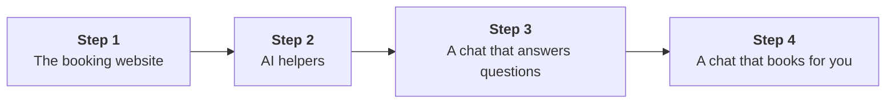
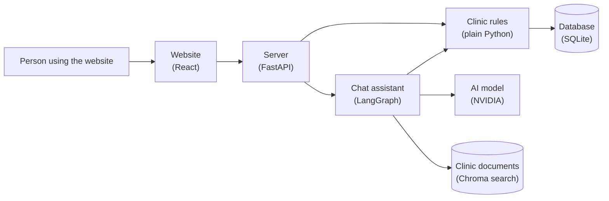
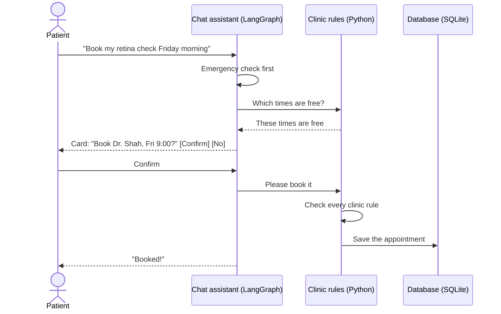
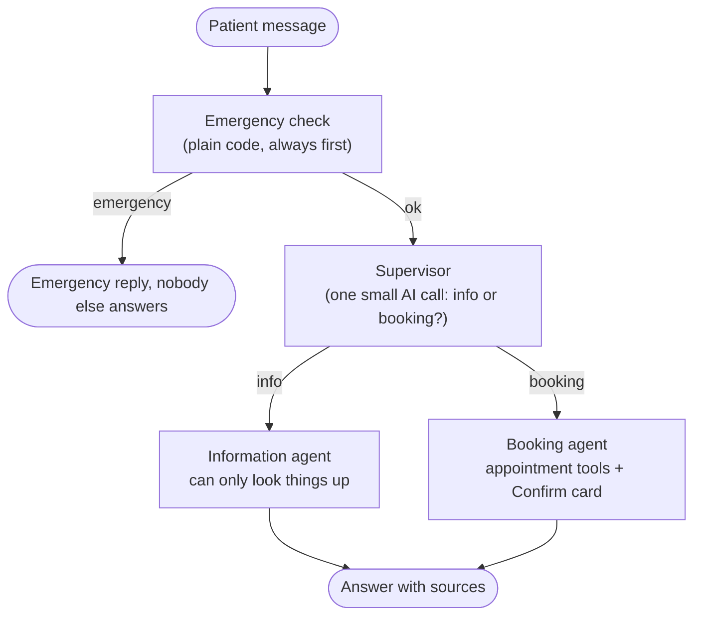
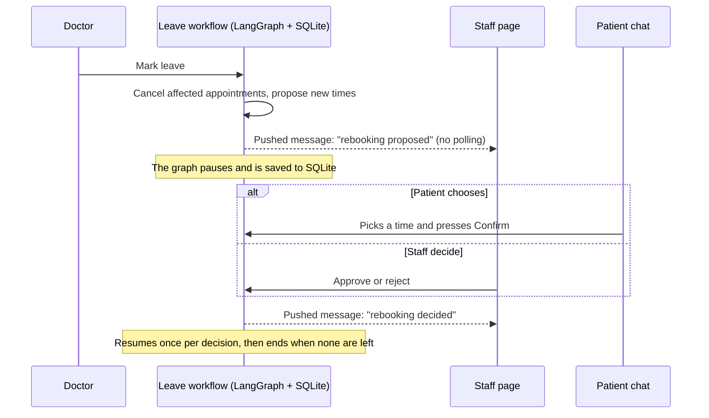
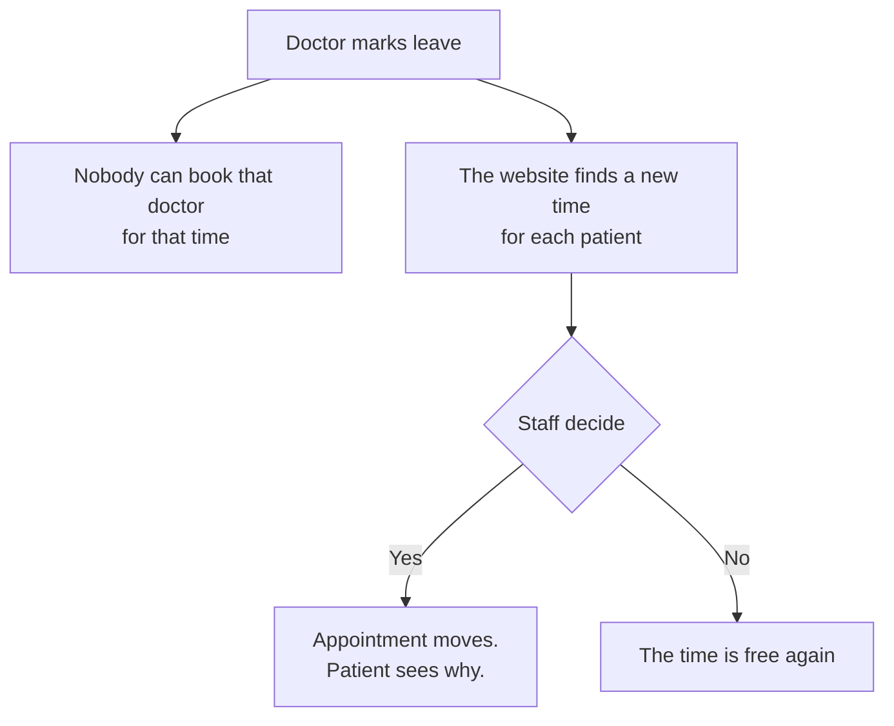

# 👁️ NetraCare: an eye clinic website with a helpful chat

NetraCare is a made-up eye clinic. It is a website with three kinds of users:

- **Patients** book, change and cancel their appointments.
- **Staff** (the front desk) run the clinic day.
- **Doctors** see their day and their patients.

There is also a **chat assistant**. A patient can type "Book me a retina check on Friday morning" and the assistant finds a free time and books it, but only after the patient presses **Confirm**.

> **The one big rule:** the AI never decides a booking. Plain computer code checks the clinic rules (opening hours, lunch break, no double booking and so on). The AI only understands the words, looks things up and explains.
>
> All the data is made up. Everything that uses AI uses a **real AI model**. Nothing is faked, not even in the tests.

### What it is built with

| Part | Technology | What it does, in plain words |
|---|---|---|
| The website you see | **React** and **Vite** | The pages, buttons and the chat window |
| The server | **FastAPI** (Python) | Receives every click, checks who you are and what you may do |
| The clinic rules | Plain **Python** | Decides if a booking is allowed |
| The database | **SQLite** | Stores patients, doctors and appointments |
| The chat assistant | **LangGraph** and **LangChain** | Runs the chat step by step: check for an emergency, think, use a tool, wait for Confirm |
| The AI model | **NVIDIA** `nemotron-3.5-lightning-30b-a3b` (OpenAI, Anthropic and Google also work) | Understands the words and writes the replies |
| Answers from the clinic documents | **Chroma** (a search database) and keyword search, with **sentence-transformers** | Finds the right piece of a document and shows where it came from |
| Tests | **pytest** and a real **Chrome** browser | Checks everything with the real AI, no fake one |
| Running it | **Docker Compose** and **nginx** | Starts the website and the server together with one command |

Sections 1 to 5 are for everyone. Sections 6 to 10 are for developers.

---

## 1. How it grew: four steps



Each step kept everything from the steps before it. This folder has all four steps together.

---

## 2. What it can do

### Step 1: the booking website
- **Log in.** (The server is FastAPI.) Patients use their mobile number and name. Staff type a name. Doctors pick their name. (There are no passwords. This is a classroom project.)
- **See the doctors** and their free times.
- **Book an appointment.** Pick a doctor, a day and a time. A new visit takes 20 minutes. A follow-up takes 10 minutes. The website checks every clinic rule.
- **Cancel or move an appointment.** A patient can do this up to 2 hours before the visit.
- **Late changes go to Staff.** If it is less than 2 hours before the visit, the request goes to Staff. The appointment stays booked until Staff say yes or no.
- **Staff can** see all appointments, book for anyone, add a new walk-in patient, add holidays, change a doctor's weekly schedule and see a doctor's week.
- **Doctors can** see their day and mark a visit as done.

### Step 2: AI helpers
- **Emergency check.** When someone books, the AI model reads the reason. If it sounds like an emergency (for example "a curtain came down over my eye"), the website shows a red message and tells Staff. If the AI cannot check, the booking is **not** made. This keeps patients safe.
- **Fact of the Day.** A short, friendly eye fact when a patient logs in.
- **Doctor summary.** A doctor opens a patient and sees a short summary of the old notes, written live on the screen (sent to the browser as server-sent events). Every visit shows its date.
- **Urgent cases.** Staff see a red number with the urgent cases they have not looked at yet.

### Step 3: a chat that answers questions
- A patient asks "How much is a new visit?" or "What should I bring?" The chat answers **from the clinic's own documents** and shows **where the answer came from**. This is called RAG (look it up first, then answer). The documents are searched with Chroma and keyword search.
- If the documents do not say, the chat says **"I don't know"**. It never guesses.
- A patient can describe a problem ("my eyes feel dry on the laptop"). The chat names the right kind of doctor. It never says what the problem might be.
- Staff can try the search themselves and see what it found.

### Step 4: a chat that books for you
- The patient writes what they want. The assistant (built with LangGraph) looks up **real free times** using nine small tools.
- Before it books, cancels or moves anything, it shows a **card with two buttons: Confirm and No.** Nothing changes until the patient presses Confirm. (This pause is a LangGraph feature called `interrupt`.)
- It remembers the chat (LangGraph memory). "Actually, make it the afternoon" works.
- It can only see and change **that patient's own** appointments.
- **Doctor leave.** A doctor marks a day off. The website cancels that day's appointments and suggests a new time for each patient. Staff say yes or no. The patient sees "Moved because Dr. … is on leave".
- A new home page and one colour style on every page.
- If the AI service is busy, the website waits and tries again. You can add a second key to share the work.

### Step 4 extras: five more things the chat and the clinic can do
- **The chat shows its progress.** While the assistant works, you see short sentences such as "Checking Dr. Shah's free times…" instead of a blank wait. (The server sends them live, using server-sent events.)
- **Patients choose a new time after doctor leave.** If a doctor's leave moves a patient's appointment, the chat tells them. It shows the time the website proposed and **two other free times**. The patient picks one and presses Confirm. Staff no longer have to decide for every patient. (Staff can still decide.)
- **Doctor leave runs as a LangGraph workflow.** It is a small graph that **pauses and waits** for each patient or Staff decision, and it **keeps its place in a SQLite file**. If the server restarts, it carries on where it stopped.
- **A Staff assistant.** The front desk has its own chat helper (a second LangGraph agent). It can show what needs attention, look up a patient, list a day's appointments, find free times, **book for a patient**, cancel, approve or reject late requests and rebookings, and mark urgent cases as seen. Every change waits for Confirm, just like the patient chat.
- **A supervisor team.** A patient can switch the chat to "Team: information + booking". A small router reads each message and passes it to an **information agent** (it can only look things up) or a **booking agent** (it has the appointment tools). The red-flag check still runs first, and every change still waits for Confirm.
- **Live updates for Staff.** The Staff page no longer asks the server every 15 seconds. The server **pushes** a small message the moment something changes (a new urgent case, a late-change request, a rebooking or a booking). The AI calls on the server are also **async**, so a slow AI answer for one person does not hold up everyone else.

- **Optional tracing with LangSmith.** If you switch it on, every chat turn becomes one **trace** in LangSmith (a web page that shows each step the assistant took, each AI call and each tool call, with how long it took). It is **off** unless you set it up (see section 6, "Tracing with LangSmith").

### Who can do what
| | Patient | Staff | Doctor |
|---|---|---|---|
| Book, cancel, move own appointments | ✅ | ✅ (for anyone) | – |
| Chat with the assistant | ✅ | ✅ (the Staff assistant) | – |
| Choose a new time after doctor leave | ✅ | ✅ (can also decide) | – |
| See urgent cases and approve late changes | – | ✅ | – |
| Search tool (see what the chat found) | – | ✅ | – |
| Mark leave, write notes, see patient summaries | – | – | ✅ |

---

## 3. How it works (the simple version)



**A booking in the chat, one step at a time**



**The supervisor team** (optional chat mode)



**Live updates and the leave workflow**



**What the AI does and what the code does** (the AI is the NVIDIA model, the code is Python)

| The AI | The plain code |
|---|---|
| Reads what the person wrote | Decides if a booking is allowed |
| Picks what to look up | Shows the card and waits for Confirm |
| Explains in friendly words | Knows who the patient is (from the login) |
| Writes the fact and the summary wording | Adds the "where this came from" line |
| | Shows the emergency message |

**If a doctor goes on leave**



---

## 4. Why it is safe

- Every chat message goes through the **emergency check first**. If the check cannot run, the chat does nothing.
- **Clinic rules are in plain code.** The AI cannot skip them.
- **Nothing changes until the patient presses Confirm.**
- The patient is known from the **login**. The AI cannot pick someone else.
- The chat **never says what a problem might be** and **never suggests a medicine or treatment**.
- Answers about the clinic show **where they came from**, or say "I don't know".
- The AI never sees the doctors' private notes.
- The secret AI key is kept in one private file (`backend/.env`) that is never shared.

---

## 5. How we tested it

We never used a fake AI. Every test that needs an AI answer asks the real AI. We checked the AI against lists of questions with known right answers.

**What we checked**
| List | What it holds |
|---|---|
| Clinic rule cases | 38 booking cases with the expected result |
| Emergency reasons | 45 reasons, each marked emergency or not (some in Hindi, Hinglish, with typos) |
| Chat questions | 20 questions with the right source. 5 should get "I don't know" |
| Problems in the patient's own words | 20 problems with the right kind of doctor |
| Booking chats | 24 chats checked against the database |
| Doctor leave cases | 5 leave cases with the new time the code should suggest |

**Results** (real AI model: NVIDIA `nemotron-3.5-lightning-30b-a3b`)
| What we checked | Result |
|---|---|
| Booking chats (24) | ✅ **24 of 24** |
| Chat questions (20) | ✅ **20 of 20** |
| Finding the right doctor, first 10 (goal: at least 9) | ✅ **9 of 10** (one case, R06, sometimes picks a general doctor) |
| Finding the right doctor, next 10 | ✅ **10 of 10** |
| Emergency check, 35 marked reasons | ✅ **No missed emergencies, no false alarms** |
| 10 hard cases (Hindi, Hinglish, typos) | ✅ **10 of 10** |
| Same 45 emergency cases on the main AI model | ✅ **45 of 45** |
| All other tests together (rules, website calls, tools, search, doctor leave) | ✅ **279 passed**, 1 failed because of a dropped internet connection, and it passed when run again |
| A real browser using the booking chat (22 steps) | ✅ **22 of 22**: card, Confirm, No, move in the same chat, sources, "I don't know", a refusal explained, an emergency, doctor leave |
| A real browser on the home page | ✅ **40 of 40** on a big screen, a tablet and a phone |
| Real browser checks of steps 1, 2 and 3 | ✅ All passed (7 of 7, 9 of 9, 8 of 8) |
| Everything that existed before, re-run after the async change (API, tools, agent, Iteration 2, keys, roles, rules) | ✅ **160 passed, 0 failed** |
| Live Staff updates and async (pushed urgent case arrives before the patient's reply, the server answers others while a chat waits, two chats overlap) | ✅ **9 of 9** (the "two chats at once" check counts how many chats the server works on at the same moment, which reached 2) |
| Doctor leave workflow and the patient's choice (pauses, any order, survives a restart, refused decisions do not touch it) | ✅ **12 of 12** (no AI call needed) |
| Staff assistant tools, progress sentences, supervisor wiring | ✅ **13 of 13** (no AI call needed) |
| The new chat features with the real AI (progress, patient chooses, Staff assistant reads and decides, Staff assistant books, supervisor routes and confirms, supervisor stops a red flag) | ✅ **7 of 7** (about 85 AI calls, none repeated) |
| A real browser using the new screens (Staff page shows "Live", an urgent case reported in the patient chat appears on the Staff page by itself, progress sentences in the chat, the Staff assistant tab and its answer) | ✅ **14 of 14** (10 + 4) |
| LangSmith tracing: off by default, needs both the switch and a key, the log line never shows the key, trace labels hold no patient data, tests can never trace by accident | ✅ **7 of 7** (no AI call needed) |
| LangSmith tracing, end to end: one chat turn appears as one trace with its steps | ⏳ written, **waiting for a LangSmith key** to run it |
| Final safety run of the Iteration 4 tests after the extras were added (agent, API, tools, async, stretch, keys) | ✅ **91 of 91** (the one stopwatch-based test was replaced by the counting test above) |

**One agent or a team?** We ran the same six messages through the single agent and the supervisor team (`python compare_agents.py`, about 65 AI calls):

| | Right | AI calls | Time |
|---|---|---|---|
| Single agent | 6 of 6 | 24 | 122 seconds |
| Supervisor team | 4 of 6 | 31 | 203 seconds |

The team used about 30% more AI calls and was slower. Its two misses did not repeat when we ran those two messages again, so they were ordinary variation. On these messages the single agent was simpler, faster and at least as good, so it stays the default. The team is there as an option and for comparison.

The AI does not give exactly the same answer every time, so a repeat run can differ by one check. These numbers come from the latest full run of each kind.

---

## 6. Run it
**1. Set your AI key (optional, but needed for the AI features)**

Copy `backend/.env.example` to `backend/.env` and fill in one provider:
```
LLM_PROVIDER=nvidia            # openai, anthropic, google or nvidia
NVIDIA_API_KEY=nvapi-...       # the key for that provider
NVIDIA_API_KEY_2=nvapi-...     # optional: a second key (up to _9) of the same provider; the app uses the keys in turn
```
The chat's embeddings need **no key**: by default they run on your own computer (`EMBEDDING_PROVIDER=local`).
`.env` is listed in `.gitignore`, so it is never committed. Never put a key anywhere else.

**2. Start the app, with Docker (easiest)**
```bash
docker compose up --build
```
Open **http://localhost:5176**. API docs: http://localhost:8004/docs.
The first build takes several minutes: it downloads the embedding model and **builds the knowledge-base index once** (from data packs 3 and 4), inside the image.
After you change a document, rebuild the index: `docker compose exec backend python build_index.py`.
`docker compose down` stops it (data is kept); `docker compose down -v` deletes the data.
The key is passed to the container when it starts. It is **not** stored in the image.

**Or without Docker** (needs Python 3.10+ and Node.js 18+)
```bash
cd backend
pip install -r requirements.txt
python build_index.py                     # builds the knowledge-base index ONCE (also after a document changes)
python -m uvicorn app.main:app --port 8000
```
```bash
cd frontend
npm install
npm run dev
```
Open **http://localhost:5173**. The first start creates `backend/netracare.db` from the CSV files.

**Logging in** (no passwords, so this is classroom-level security only)

| Role | Enter |
|---|---|
| Patient | A mobile number and name from [`patients.csv`](backend/data/patients.csv), for example `9000000001` / `Asha Verma` |
| Staff | Any name |
| Doctor | Pick a name from the list |


---

### Tracing with LangSmith (optional)

LangSmith is a free web tool that shows **what the assistant did, step by step**: the emergency check, each AI call, each tool call and how long each took.
It is switched **off** by default.

**How to get a free key**
1. Go to **smith.langchain.com** and sign up (Google, GitHub or email). The free plan is called "Developer". It has a monthly limit on traces.
2. Open **Settings, then API Keys, then Create API Key**. Name it `netracare` and copy the key (it starts with `lsv2_`).
3. Put these lines in `backend/.env` (this file is never shared):
```
LANGSMITH_TRACING=true
LANGSMITH_API_KEY=lsv2_...
LANGSMITH_PROJECT=netracare-iteration4
```
4. Restart the server. The server log says "LangSmith tracing is ON". Chat with the assistant, then open your project in LangSmith: each chat turn is one trace.

**Good to know**
- Tracing sends the chat messages and the AI's replies to LangSmith's servers. All data here is made up, but if you do not want the text sent, add `LANGSMITH_HIDE_INPUTS=true` and `LANGSMITH_HIDE_OUTPUTS=true`. The traces then show the steps and timings without the words.
- Traces are labelled `netracare`, `patient-chat` or `staff-chat`, and with the chat mode. The labels hold no patient name, number or message text.
- The automated tests never send traces, even when a key is in `.env`. To check tracing on purpose: `set NETRACARE_TEST_TRACING=1` and run `python -m pytest tests/test_iteration4_tracing_live.py -v -s`.

---

# For developers

Sections 7 to 10 are reference material: the clinic rules, the API, the data and settings, and the files.

## 7. Clinic rules (Iteration 1, plus doctor leave)

Checked in this order, after the red-flag check. Each refusal has a short code and a plain sentence.

| # | Rule | Code |
|---|---|---|
| 1 | Start on a 10-minute mark (new consultation = 20 min, follow-up = 10 min) | `INVALID_START_TIME` |
| 2 | Not in the past | `IN_PAST` |
| 3 | At most 30 days ahead | `BEYOND_30_DAYS` |
| 4 | Not on a Sunday | `CLINIC_CLOSED` |
| 5 | Not on a holiday | `HOLIDAY` |
| 6 | Inside 09:00-13:00 or 14:00-18:00 | `OUTSIDE_SESSION` |
| 7 | Must finish before the session ends | `ENDS_AFTER_SESSION` |
| 8 | Doctor is at the clinic that session | `DOCTOR_OFF` |
| 9 | Doctor is not in surgery | `SURGERY_SESSION` |
| 9b | Doctor has not marked leave for that session (Iteration 4) | `DOCTOR_ON_LEAVE` |
| 10 | Doctor covers that speciality | `SPECIALITY_MISMATCH` |
| 11 | Slot is not already taken | `DOUBLE_BOOKED` |
| 12 | A follow-up needs a completed earlier visit, with the same doctor | `NO_PREVIOUS_VISIT`, `FOLLOW_UP_DIFFERENT_DOCTOR` |
| 13 | One active booking per speciality | `ACTIVE_BOOKING_EXISTS` |
| 14 | A patient can cancel or reschedule until 2 hours before. After that: "Please contact Staff" (the request is saved for Staff to approve or reject) | `INSIDE_2_HOURS` |

New in Iteration 2: `REASON_REQUIRED`, `REASON_TOO_LONG`, `NOTE_REQUIRED`, `NOTE_TOO_LONG`, `RED_FLAG_CHECK_FAILED`.

## 8. API

All paths start with `/api` in the browser (the web server removes it before calling FastAPI). Try them at `/docs`.
Protected calls need the header `Authorization: Bearer <token>`.

| Method | Path | Who | What it does |
|---|---|---|---|
| GET | `/health` | public | Is the server up, and what time does the clinic think it is |
| POST | `/login` | public | Log in as `patient`, `staff` or `doctor`; returns a token |
| GET | `/doctors` | public | The 5 doctors and their specialities |
| GET | `/me` | any logged-in user | Who am I |
| GET | `/schedule` | any logged-in user | Doctors' weekly schedule |
| GET | `/holidays` | any logged-in user | Clinic holidays |
| GET | `/slots/preview` | **public** | `?speciality=` The next free new-consultation times for a speciality (up to 6), with the doctors who cover it. Times and doctor names only. Used by the home page |
| GET | `/slots` | any logged-in user | Free start times for a doctor, date, speciality and visit type |
| GET | `/appointments` | any logged-in user | List appointments (patients and doctors only see their own; only doctors see the doctor's note) |
| POST | `/appointments` | patient, staff | Book. Needs a `reason`. Runs the red-flag check first. |
| POST | `/appointments/{appointment_id}/cancel` | patient, staff | Cancel |
| POST | `/appointments/{appointment_id}/reschedule` | patient, staff | Move to another time (the old one is cancelled only if the new one is accepted) |
| POST | `/appointments/{appointment_id}/complete` | doctor | Mark the doctor's own visit completed. Needs a `note`. |
| GET | `/fact-of-the-day` | patient | The patient's saved eye fact (instant). `?refresh=true` writes a different one and saves it as the replacement. |
| GET | `/doctor/patients/{patient_id}/summary` | doctor | Structured AI summary of the recorded notes (`?appointment_id=` one on the doctor's own schedule) |
| GET | `/doctor/patients/{patient_id}/summary/stream` | doctor | The same summary streamed as it is written (server-sent events: `meta`, many `partial`, one `final`) |
| POST | `/chat` | patient | `{thread_id, message}` (up to 500 characters) or `{thread_id, confirm: true\|false}` from the card. Returns `kind` (`answer`, `pending`, `idk`, `emergency`, `check_failed` or `error`), `reply`, `sources`, `tool_calls` and, while an action waits, `pending_action` (`{action, summary}`). The patient comes from the login. |
| POST | `/chat/stream` | patient | The same as `/chat`, but streamed: `step` events ("Checking Dr. Shah's free times…") and then one `final` event with the same answer |
| POST | `/chat` (field `mode`) | patient | `"mode": "supervisor"` uses the information + booking team. The default is `"single"` |
| POST | `/staff/chat`, `/staff/chat/stream` | staff | The Staff assistant. Same body and answer as the patient chat. Every change waits for Confirm |
| GET | `/staff/events` | staff | Live updates (server-sent events): `hello`, `ping`, and one small event per change (`urgent_case`, `approval`, `rebooking`, `appointments`) |
| GET | `/doctor/leave/{leave_id}/progress` | doctor, staff | Where the leave workflow is: still waiting for decisions (which rebookings) or finished |
| GET | `/staff/search-debug` | staff | `?q=` the top 4 chunks from keyword, vector and hybrid search, each with file, section and score |
| POST | `/doctor/leave` | doctor | Mark leave `{date, session: AM\|PM\|FULL}` within the next 30 days; cancels the affected appointments and proposes new times |
| GET | `/doctor/leave` | doctor | The doctor's own leave |
| GET | `/staff/rebookings` | staff | Proposals waiting for Staff (`no_slot` rows say "No slot: call the patient") |
| POST | `/staff/rebookings/{rebooking_id}/approve` | staff | The proposal becomes a booked appointment |
| POST | `/staff/rebookings/{rebooking_id}/reject` | staff | The proposal is dropped and its slot is free again |
| GET | `/urgent-cases` | staff | Urgent cases not yet seen (each has `source`: `booking` or `chat`) |
| POST | `/urgent-cases/{urgent_id}/seen` | staff | Mark an urgent case seen |
| GET | `/patients` | staff | List patients |
| POST | `/patients` | staff | Register a walk-in patient |
| GET | `/staff/approvals` | staff | Late cancel/reschedule requests waiting for Staff |
| POST | `/staff/approvals/{approval_id}/approve` | staff | Approve and carry it out |
| POST | `/staff/approvals/{approval_id}/reject` | staff | Reject; the appointment stays |
| POST | `/holidays` | staff | Add a holiday |
| DELETE | `/holidays/{date}` | staff | Remove a holiday |
| PUT | `/schedule` | staff | Set a doctor's status (OPD, SURGERY or OFF) for a day and session |
| GET | `/calendar` | staff, doctor | One doctor's week (a doctor always gets their own) |

When a rule is broken the reply is HTTP 409 like this (a red-flag booking that is refused also carries an `emergency` object):
```json
{ "detail": { "code": "DOCTOR_OFF", "message": "Dr. Meera Iyer is not at the clinic on Thursdays.", "to_staff": false } }
```
Other errors: 401 not logged in, 403 not allowed for your role, 404 not found, 422 bad input, 503 the red-flag check could not run.

## 9. Data and settings

| Data pack | File | Rows | Used for |
|---|---|---|---|
| 1 | `backend/data/doctors.csv` | 5 | Doctors and their specialities |
| 1 | `backend/data/weekly_schedule.csv` | 60 | OPD / SURGERY / OFF for each doctor, day and session |
| 1 | `backend/data/holidays.csv` | 30 | Days the clinic is closed |
| 1 | `backend/data/patients.csv` | 25 | Patients |
| 1 | `backend/data/stretch/appointments_seed.csv` | 19 | Sample bookings, only if you ask; used by the tests |
| 1 | `backend/data/stretch/rule_tests.csv` | 38 | Test cases for the rules |
| 2 | `backend/data2/past_visits.csv` | 27 | Completed visits with the patient's reason and the doctor's note |
| 2 | `backend/data2/patient_profiles.csv` | 25 | General health and allergies |
| 2 | `backend/data2/reason_samples.csv` | 35 | Reasons labelled red flag yes/no, to test the AI check |
| 3 | `backend/data3/documents/doctors.md` | 15 sections | Which speciality sees which problems; each doctor's specialities and OPD days |
| 3 | `backend/data3/documents/procedures.md` | 9 sections | Tests and procedures: what happens, before and after, indicative cost |
| 3 | `backend/data3/documents/clinic_policy_faq.md` | 14 sections | Timings, booking, fees, cancelling, what to bring, dilation, emergencies |
| 4 | `backend/data4/documents/clinic_policy_faq.md` | 16 sections | Replaces the data pack 3 policy document (new: booking through the chat, doctor leave) |
| 4 | `backend/data4/agent_scenarios.csv` | 24 | Chat scenarios with the expected tools and database result, on the fixed clock |
| 4 | `backend/data4/leave_scenarios.csv` | 5 | Doctor leave cases with the rebooking the code should propose |
| 3 | `backend/data3/questions.csv` | 20 | Patient questions with the expected source; Q16 to Q20 should get "I don't know" |
| 3 | `backend/data3/routing_samples.csv` | 20 | Problems in patients' own words, labelled with the right speciality |

There are **no upcoming bookings** at the start. Data pack 2's 27 past visits are loaded as completed appointments, so follow-ups work (for example Asha Verma can book a Retina follow-up with Dr. Shah).

Settings (environment variables):

| Variable | Meaning |
|---|---|
| `LLM_PROVIDER` | `openai`, `anthropic`, `google` or `nvidia` (in `backend/.env`) |
| `LLM_MODEL` | Model name. If blank: `gpt-4o-mini`, `claude-haiku-5-5`, `gemini-2.0-flash` or `nvidia/nemotron-3.5-lightning-30b-a3b` |
| `LLM_TIMEOUT` | Seconds before an AI call gives up (default 20) |
| `LLM_MAX_RETRIES` | Retries after a short provider error such as HTTP 429 "too many requests" (default 4) |
| `LANGSMITH_TRACING`, `LANGSMITH_API_KEY`, `LANGSMITH_PROJECT` | Optional tracing. Off unless the first two are set (see "Tracing with LangSmith") |
| `LANGSMITH_HIDE_INPUTS`, `LANGSMITH_HIDE_OUTPUTS` | Optional: do not send the text that goes into or comes out of each step |
| `LLM_RATE_LIMIT_WAITS` | Seconds to wait before each further try when the provider answers HTTP 429 (default `4,8,16`; about 1 second when a second key can take the next try). Any other error is not retried |
| `NVIDIA_API_KEY_2` ... `_9` | Optional extra keys for the same provider. They are used in turn, which spreads the calls over several rate limits |
| `LLM_FALLBACK_MODELS` | Optional backup models, comma separated (`provider:model`). Tried in order if the main model fails; booking is refused only if all of them fail. Blank = main model only |
| `NVIDIA_BASE_URL` | NVIDIA only: the API address (default `https://integrate.api.nvidia.com/v1`) |
| `NETRACARE_SEED_APPOINTMENTS` | Set to `1` to also load the 19 sample bookings |
| `NETRACARE_SKIP_PACK2` | Set to `1` to skip data pack 2 |
| `CLINIC_NOW` | Freeze the clinic clock, for example `2026-11-02T10:00` (demos and tests) |
| `CLINIC_TZ` | Docker only: the clinic's timezone (default `Asia/Kolkata`) |
| `NETRACARE_DB` | Where the SQLite file lives |
| `NETRACARE_DATA_DIR` | Where data pack 1 is |
| `NETRACARE_DATA2_DIR` | Where data pack 2 is |
| `NETRACARE_DATA3_DIR` / `NETRACARE_DATA4_DIR` | Where data pack 3 / 4 are |
| `NETRACARE_DOCS_DIR` | Tests only: use this folder of documents instead of data packs 3 and 4 |
| `NETRACARE_INDEX_DIR` | Where the Chroma index is saved (default `backend/chroma_db`) |
| `EMBEDDING_PROVIDER` | `local` (free, on your computer, the default), `openai` or `google` |
| `EMBEDDING_MODEL` | Optional model name. **If you change it, rebuild the index** (`python build_index.py`) |
| `BACKEND_PORT` | Dev server only: port of the backend (default `8000`) |

The four data pack folders are copied exactly as given, including their `.DS_Store` files.

Plus the key for your provider: `OPENAI_API_KEY`, `ANTHROPIC_API_KEY`, `GOOGLE_API_KEY` or `NVIDIA_API_KEY`.

### Run the tests yourself
```bash
cd backend
pip install -r requirements-dev.txt
python -m pytest -q                                          # everything except the two scorings below
python -m pytest tests/test_chat_live.py -v -s               # the 20 questions + 20 problems, with a score
python -m pytest tests/test_agent_scenarios_live.py -v -s    # the 24 booking chats, checked against the database
```
The tests need your AI key and take a while, because every answer is a real call.

## 10. Project files

```
backend/
  app/
    main.py       the API routes and role checks
    service.py    the actions (book, cancel, complete, urgent cases, ...)
    rules.py      every clinic rule
    llm.py        the booking AI: model setup, Fact of the Day, red-flag check, doctor summary
    rag.py        the knowledge base: chunking, Chroma, BM25, hybrid search, the rewrite and answer chains
    agent.py      the LangGraph agent: the graph, its prompt, memory, one chat turn
    tools.py      the 9 tools (a thin layer over the same API functions the website uses)
    ops.py        the ONE booking path, doctor leave, Staff rebooking and the patient's choice of a new time (plain code)
    leave_flow.py doctor leave as a LangGraph workflow that pauses and is saved in SQLite
    staff_agent.py the Staff assistant (a second LangGraph agent)
    supervisor.py the information + booking team behind a router
    events.py     the live-update hub for the Staff page
    db.py         database tables and CSV loading
    config.py     settings and the clinic clock
  data/           data pack 1 (CSV files)
  data2/          data pack 2 (CSV files)
  data3/          data pack 3 (the 3 documents, questions.csv, routing_samples.csv)
  data4/          data pack 4 (the updated policy document, agent_scenarios.csv, leave_scenarios.csv)
  build_index.py  builds the knowledge-base index (run once, and after a document changes)
  chroma_db/      the saved index
  tests/          the automated tests (+ hard_cases.csv, my own 10 extra red-flag cases)
  compare_models.py   runs the same 45 red-flag cases on any models you name
  .env.example    copy to .env and add your key
frontend/
  src/App.jsx     all the screens
  src/api.js      talks to the API
docker-compose.yml   runs backend + frontend together
```

## 🛠️ Built with
Python, FastAPI (async, server-sent events), SQLite (no ORM), LangChain, LangGraph (with a SQLite checkpoint), Chroma, BM25, sentence-transformers · React 18, Vite 5 · pytest · Docker Compose, nginx
